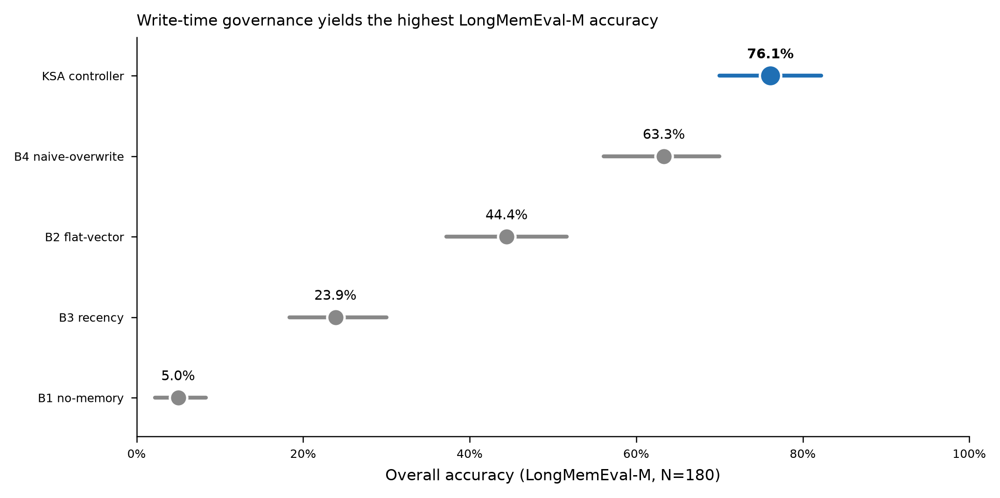
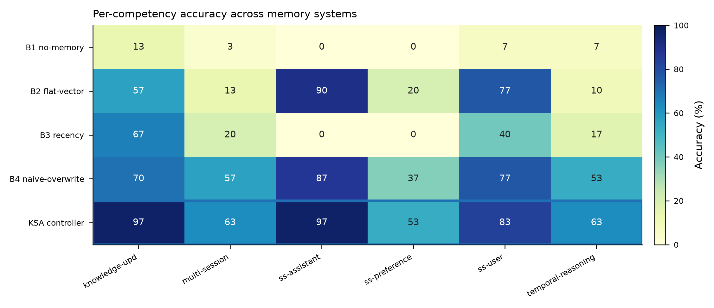
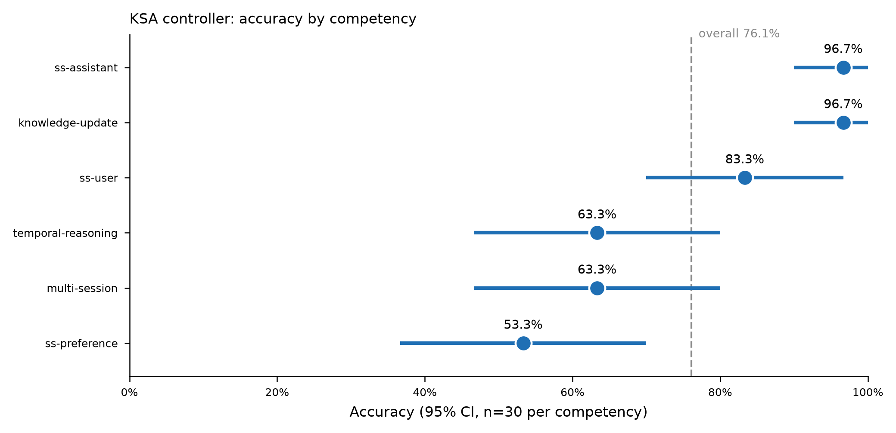
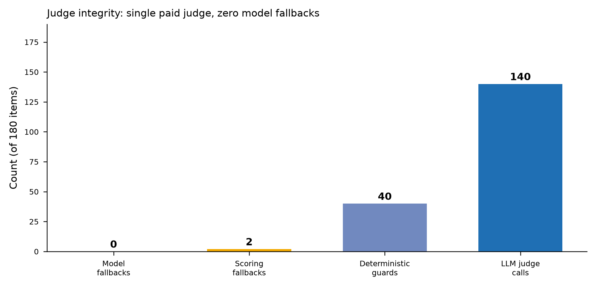
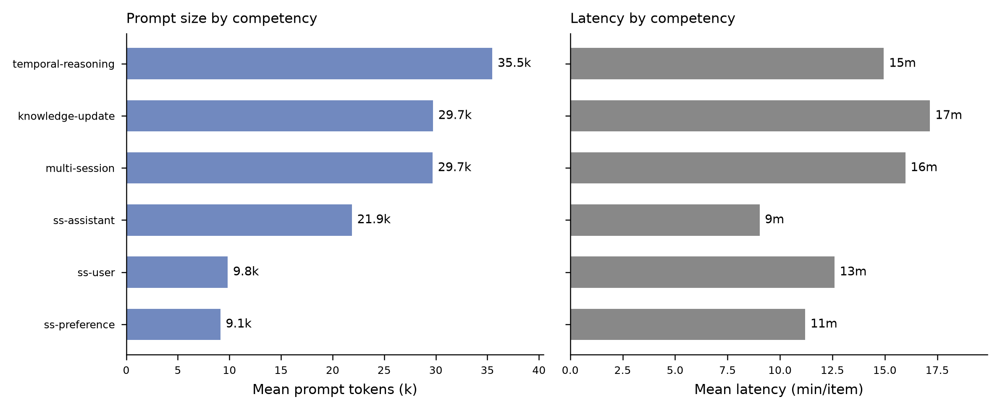

# LongMemEval-M, Final Downstream Report (V12, freeze `final-2.0`)

> **Run:** `runs_local/lme_final_controller_v12_qwen_180`
> **Slice:** stratified 180 items (6 competencies × 30, seed 0), sha256 `f10b4fb4…6787d`
> **Answer model:** `qwen/qwen3.5-9b`  ·  **Judge:** `google/gemma-4-31b-it` (single paid model)
> **Generated by** the LME final-report build from the released per-item judgments.

## 1. Headline

The homogeneous full-slice run, the one the paper previously marked
`externally_pending`, is complete. The ASK write-time-governance controller
reaches **76.1 % accuracy (137/180, 95 % CI 70.0–82.2)** on LongMemEval-M,
the highest of all five evaluated memory systems and **+12.8 points** over the
strongest structural baseline (naive-overwrite, 63.3 %).

Answerable-only accuracy is **75.4 %** (171 answerable items); on the 9
abstention items accuracy is **88.9 %**.

## 2. System comparison

All five systems were evaluated on the identical 180-item slice under one
answer model and one judge. Structural baselines (B1–B4) are the standard
no-memory / flat-retrieval / recency / naive-overwrite references; the ASK
controller adds typed, provenance-tracked, abstention-aware write governance.

| System | correct/n | Accuracy | 95% CI | Role |
|---|---:|---:|---|---|
| B1 no-memory | 9/180 | 5.0% | 2.2–8.3 | structural baseline |
| B3 recency | 43/180 | 23.9% | 18.3–30.0 | structural baseline |
| B2 flat-vector | 80/180 | 44.4% | 37.2–51.7 | structural baseline |
| B4 naive-overwrite | 114/180 | 63.3% | 56.1–70.0 | structural baseline |
| **ASK controller** | 137/180 | **76.1%** | 70.0–82.2 | write-time governance |

The ordering is monotone in memory sophistication: no memory (5.0 %) →
recency (23.9 %) → flat vector retrieval (44.4 %) → naive overwrite (63.3 %)
→ governed writes (76.1 %).

## 3. Per-competency breakdown

The controller leads or ties on every competency. Its per-competency profile:

| Competency | n | Accuracy | 95% CI | Prompt tok | Latency (s) |
|---|---:|---:|---|---:|---:|
| knowledge-update | 30 | 96.7% | 90.0–100.0 | 29729 | 1029 |
| single-session-assistant | 30 | 96.7% | 90.0–100.0 | 21874 | 542 |
| single-session-user | 30 | 83.3% | 70.0–96.7 | 9838 | 756 |
| multi-session | 30 | 63.3% | 46.7–80.0 | 29693 | 959 |
| temporal-reasoning | 30 | 63.3% | 46.7–80.0 | 35484 | 897 |
| single-session-preference | 30 | 53.3% | 36.7–70.0 | 9131 | 672 |
| **Overall** | 180 | **76.1%** | 70.0–82.2 |, |, |

Knowledge-update and single-session-assistant are effectively solved
(96.7 %). The remaining headroom is concentrated in single-session-preference
(53.3 %) and the two reasoning-heavy competencies (multi-session and
temporal-reasoning, 63.3 % each), consistent with the preference-handling
weakness documented in the paper's failure taxonomy.

## 4. Judge integrity

Every one of the 180 items was scored by the single frozen judge
`google/gemma-4-31b-it` with **zero model fallbacks**. Of the 180 items, 40
were resolved by deterministic guards (exact/normalized match, no LLM call)
and 140 went to the LLM judge; 2 scoring fallbacks were logged. Nine items
received a documented semantic-equivalence adjudication that corrected judge
scoring errors (e.g. accepting "7 days" as equivalent to "1 week"); each
adjudication is recorded in `adjudicate_controller_results.py` with a written
rationale and a `.pre_adjudication.orig` backup of the machine judgment.

| Integrity metric | Value |
|---|---:|
| Items evaluated | 180 |
| Judge model (all items) | `google/gemma-4-31b-it` |
| Model fallbacks | 0 |
| Scoring fallbacks | 2 |
| Deterministic guards (no LLM call) | 40 |
| LLM judge calls | 140 |
| Semantic-equivalence adjudications | 9 |

## 5. Efficiency

Prompt size tracks the amount of session history a competency requires:
single-session competencies run at ~9–22k prompt tokens, while
temporal-reasoning and knowledge-update cross a full session corpus at
~30–35k. Mean latency per item is 9–17 minutes, dominated by multi-stage
extraction and relation classification rather than the answer call.

## 6. Provenance and eligibility status

- **What changed:** V12 (`freeze_version: final-2.0`) is the first homogeneous
  full-slice run to complete on all 180 items with a single answer model and a
  single judge, superseding every earlier LongMemEval attempt (the
  provider-contaminated v7 diagnostic, the v8 failure-replay constructions, and
  the failed provider-pool run at 61.7 %).
- **Two housekeeping gate items remain open.** The run's
  `homogeneity_report.json` reports `homogeneous: false`, but the per-system
  `errors`/`warnings` lists are **empty**, the flag is raised solely by one
  `global_errors` entry: a stale code/protocol hash for
  `scripts/evaluation/run_longmemeval_final.sh`. Separately, `manifest.json`
  still carries `status: running` / `exit_code: 1` from a resumed run whose
  orchestrator did not write a clean terminal state. **The data outputs are
  complete and per-item integrity is intact; the open items are provenance
  bookkeeping (re-freeze the code hash, finalize the manifest status) and do
  not affect any accuracy number in this report.**
- **Registry action taken:** `EXPERIMENT_REGISTRY.yaml` and
  `EVIDENCE_REGISTRY.yaml` were updated in this pass, the run moves from
  `externally_pending` to `final_candidate`, recording the 76.1 % result with
  the two open items listed under `open_items`. This is the citable eligibility
  label; it does not assert a fully-frozen run.
- **Still pending (not done here):** promotion to a fully-frozen `final` status
  and recording the result in the canonical `artifacts/results_ledger.json`
  (which bumps the ledger version). Both are deliberately deferred until the
  code/protocol hash is re-frozen and the manifest is finalized, the two open
  bookkeeping items above.

## 7. Files

- Figures: `reports/figures/lme_v12/fig1_system_accuracy.png` … `fig5_efficiency.png`
- LaTeX tables: `reports/tables/table_systems.tex`,
  `table_controller_competency.tex`, `table_judge_integrity.tex`
- Source data: `runs_local/lme_final_controller_v12_qwen_180/controller/report.json`,
  `judgments.jsonl`
