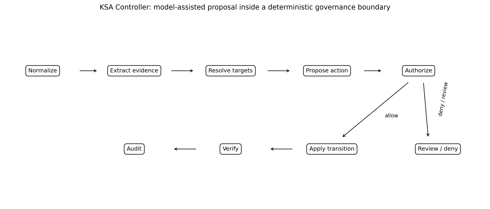
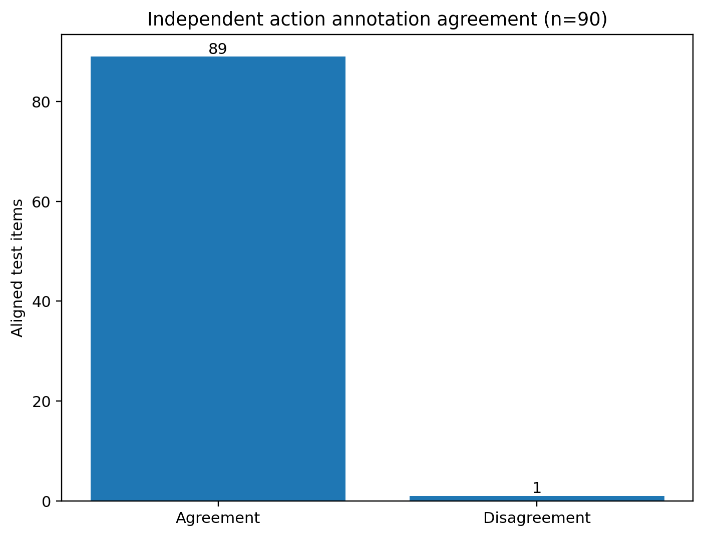

# Auditable Governance of Long-Term Memory in Language Agents

## The ASK Controller (Keep–Supersede–Abstain), the MGP-6 v2 Diagnostic, and Evidence-Bounded Evaluation

**Master's Thesis, English Review Draft**
Administrative fields are consolidated in `frontmatter/ADMINISTRATIVE_FIELDS.md`. Verified values are present; fields that require official records remain empty and must never be inferred by tooling.

Persian-language front matter is available in `frontmatter/abstract_fa.md`, `frontmatter/extended_summary_fa.md`, and `frontmatter/terminology_fa.md`.

> **Evidence-status notice.** Every number in this thesis is transcribed from the frozen evidence ledger `artifacts/results_ledger.json` v1.1 (sha256 `fea886f1ae746e921e785536e6ce47bea89ec11b99f8f2e75936dc71c6c5185e`, created 2026-07-13) or the later construct-validity audit `artifacts/analysis/mgp6_validity_audit.json`. The 2026-07-15 shortcut failure supersedes the ledger's older `final_candidate` interpretation for MGP-6 v2: those policy rows are now diagnostic. No `failure_replay_only`, `incomplete`, `invalid`, `externally_pending`, or mapping-dependent row is used as a primary capability result. Conversion to the official University of Tehran thesis template and completion of its administrative fields remain external requirements (see `thesis/README.md` and `thesis/thesis_checklist.md`).

---

## Declaration

This manuscript distinguishes verified results, supported-with-caveat results, diagnostic observations, and hypothesized designs, following the strength tags of `reports/CLAIMS_EVIDENCE_MATRIX.md`. Invalid and superseded runs are named and excluded (`docs/audit/INVALID_AND_SUPERSEDED_RUNS.md`). Raw and adjudicated numbers are always reported together. No LongMemEval number is presented as final.

## Abstract

Long-term memory makes language agents more useful and, at the same time, creates a governance problem: the agent must decide what to keep, what to supersede when new evidence contradicts stored state, and when to abstain because the evidence is insufficient to justify a write. These write-time decisions are not the same construct as downstream answer accuracy, and evaluations that collapse them conceal both capability and risk.

This thesis formulates memory governance as an explicit, auditable three-way decision, KEEP, SUPERSEDE, ABSTAIN, over typed, provenance-tracked records, and separates evaluation of the write action, the resulting state and lineage, and the later answer. It reports two instruments. The first, MGP-6 v2, is an author-designed 180-item pilot whose most important result is a *failed* construct-validity gate: a conflict-type-only lookup fitted on train and development reaches 1.000 held-out accuracy without reading the dialogue or memory state (type-only: 0.9667). That failure motivated the second instrument.

MGP-6 v4.3 is a 900-item human-authored controlled synthetic diagnostic in 100 semantic components across 20 domains, split by component into exactly action-balanced train (180), development (180), and sealed hidden (540) partitions, with duplicate, shortcut, allowlist, and deterministic-build gates passed at release and dual human annotation covering every item. One pre-registered configuration, a composed controller pairing a public-evidence rule policy with a live model policy under a conservative abstention guard, was run exactly once on the sealed split. It attains **0.8481 accuracy** and **0.8479 macro-F1** (component-cluster 95% intervals [0.8037, 0.8889] and [0.8021, 0.8894]; Cohen's κ = 0.7722 against balanced gold). The component-cluster interval is roughly 40% wider than an item-independence interval, which is the correct width and the one reported.

The thesis argues that the error *structure* carries more governance information than the aggregate, and reports it accordingly. Of 38 mishandled ambiguous items, 30 become KEEP, leaving the stored state byte-identical and losing only the audit record, while just 8 replace an active record on insufficient evidence (0.0444, CI [0.0227, 0.0852]). A single "false commit" rate of 0.2111 therefore overstates the state-corrupting harm roughly fivefold. Missed updates run 0.0833 and destructive overwrites 0.0611. Component decomposition shows neither the rule policy nor the model policy alone exceeds 0.750 on development data, so the result is a genuine composition rather than a rule engine with a model attached. Each write decision costs a 1.3 s median and 393 prompt tokens, below every full-context baseline it outperforms; monetary cost is recorded as unavailable rather than estimated, because provider telemetry emitted no price field.

On the development split, every structural baseline, every component ablation, the zero-shot policy, the standalone rule policy, and three deployed external memory systems fall between 0.2944 and 0.3667, at or below the 0.3333 chance rate of the balanced decision, failing in two opposite ways: commit-happy systems overwrite 77–98% of records they should keep, while abstain-happy systems decline 78–98% of decisions they should make. The composed controller reaches 0.8444 and its successor configuration 0.9611, with every controller-versus-baseline contrast rejecting at Holm-corrected p < 1.6e−19.

As downstream evidence, a homogeneous full-slice LongMemEval-M run (all 180 items, one answer model, one judge, zero judge fallbacks) places the governed controller at 76.1%, above every structural baseline (naive overwrite 63.3%; paired p = 2.9e−04), with the gain concentrated in knowledge-update and preference competencies rather than spread uniformly, the pattern a write-policy effect should produce.

What the evidence cannot support is stated as flatly as what it can. Only one hidden configuration was authorised, so every baseline and ablation contrast is development evidence on the split used for selection; the collections are synthetic, English-only, single-slot, and single-step; human annotation is owner-attested rather than identity-authenticated; and the abstention mechanism is not a calibrated selective predictor, its selective accuracy (0.8449) falls below its overall accuracy (0.8481). The thesis contributes an auditable evaluation decomposition, a released benchmark with build-time construct gates, per-item predictions with cluster-aware and cost-conditional analysis, and a prospective independently generated multi-human confirmation protocol. It does not establish population safety, calibrated confidence, or long-lived deployment performance.

**Keywords:** long-term memory, language agents, memory governance, supersession, abstention, provenance, lineage, auditability, diagnostic evaluation, construct validity, selective prediction, error decomposition, MGP-6 v4.3, ASK Controller, LongMemEval.

## Acknowledgements

Institutional and personal acknowledgements are administrative front matter and will be added from `frontmatter/ADMINISTRATIVE_FIELDS.md` before submission. The technical package acknowledges the LongMemEval authors [@wu2025longmemeval], the maintainers of the evaluated external memory systems, and the annotation panel configuration documented in the ledger.

## Reader's guide

Chapter 1 frames the research problem and questions. Chapter 2 situates the work in agent memory systems, memory lifecycle research, benchmarks, belief revision, and selective prediction, including the 2026 near neighbors. Chapter 3 formalizes the problem and threat model. Chapter 4 specifies the ASK Controller as implemented. Chapter 5 documents MGP-6 v2 and its annotation evidence. Chapter 6 defines the experimental methodology and the claim-eligibility policy. Chapter 7 reports results. Chapter 8 gives the error analysis and discussion. Chapter 9 addresses validity, ethics, and limitations. Chapter 10 concludes. Appendices A–F provide schemas, prompt pointers, metric definitions, the annotation-manual pointer, reproducibility commands, and the artifact manifest.

## Abbreviations

| Term | Meaning |
|---|---|
| ASK | Keep–Supersede–Abstain: the three-action memory-governance controller of this thesis |
| MGP-6 v2 | Author-designed six-type memory-governance diagnostic slice (180 scenarios) |
| LME-M | Stratified 180-item LongMemEval-M evaluation slice (6 competencies × 30, seed 0) |
| SSP | Single-session preference (LongMemEval competency) |
| RD | Paired risk difference (accuracy difference on the same items) |
| CI | Confidence interval |
| IAA | Inter-annotator agreement (not claimed here; see §5.5) |
| n.s. | Not statistically significant |
| JSONL | JSON Lines format |


# 1. Introduction and Research Questions

## 1.1 Motivation

A language model with no persistent memory cannot reliably carry preferences, commitments, or corrections across sessions. A language model with persistent memory is risky for the opposite reason: stale facts can keep influencing behavior after the user has corrected them, contradictory records can accumulate silently, and a system can act on information it should have refused to write in the first place. The engineering objective is therefore not "remember as much as possible" but to govern the memory write as a decision under explicit policy.

This observation changes where control must live. Prompting a model to "be careful" is insufficient because memory writes have side effects that outlive the prompt. A new candidate fact must be classified against the existing store, is it independent, a duplicate, or a contradiction of a prior record?, and the resulting action must be explicit and auditable: keep the new record alongside the old, supersede the old record while preserving its lineage, or abstain because the evidence is too ambiguous to commit either way. When a system cannot express the third option, every conflict becomes a silent overwrite or a silent duplicate.

Existing evaluations mostly treat memory as an answer-retrieval problem: given a long interaction history, can the model answer a later question [@wu2025longmemeval; @maharana2024locomo]? That view is valuable but incomplete: end-to-end question accuracy cannot attribute a failure to the write decision that caused it, and it cannot see governance failures that happen not to affect the sampled questions. A governance evaluation must score the decision boundary itself.

## 1.2 Research problem

> How can a language-agent memory system make and audit policy-sensitive write decisions, keep, supersede, abstain, and how can those decisions be evaluated without conflating governance correctness with retrieval or answer quality?

The problem decomposes into five concerns: **representation** (typed memory records with provenance and lineage), **decision** (an interpretable, abstention-aware action policy), **execution** (supersession must actually mark the prior record inactive and preserve its lineage), **measurement** (decision-level metrics with correct denominators, plus state metrics such as lineage integrity and stale retrieval, distinct from answer metrics), and **honest reporting** (every number carries a claim-eligibility label; contaminated or patched runs are labeled as such).

## 1.3 Research questions

**RQ1, Architecture.** What controller decomposition makes memory-write decisions explicit, interpretable, and auditable, and prevents a language model from mutating memory outside a governed action vocabulary?

**RQ2, Diagnostic.** Can a compact, author-designed diagnostic slice expose memory-governance failures, invalid commits, premise acceptance, lineage loss, that are invisible to downstream answer accuracy?

**RQ3, Measurement.** Which metrics separate decision correctness, memory-state correctness, and downstream answer behavior, and which shipped metrics fail (and must be disclosed as failing)?

**RQ4, Reliability.** How far do the reported conclusions survive paired significance testing with multiplicity control, annotation audit, and adversarial review of run provenance?

**RQ5, Reproducibility.** What artifact and claim controls keep a thesis, its papers, and its code mutually consistent, including when the honest answer is "this number is not final"?

## 1.4 Hypotheses and their outcomes (preview)

The original directional comparisons are not confirmatory because the pilot fails its shortcut gate. Chapter 7 therefore treats them as diagnostics and reports these outcomes:

- **H1, Governance framing helps an LLM.** Not identified by v2: structured and unstructured prompts differ on a label-leaking collection, so the observed gap is descriptive.
- **H2, An interpretable reference policy can match an LLM policy.** No superiority or non-inferiority conclusion: test accuracy is 0.8889 versus 0.9000 and the family-clustered paired interval includes zero.
- **H3, Abstention is load-bearing for action safety.** Mechanistically supported inside the generator, but not validated externally; zero observed action false commits has a non-zero finite-sample upper bound and accompanies missed updates.
- **H4, Decision and stored-state metrics can diverge.** Supported as a measurement demonstration: the no-lineage ablation preserves action accuracy while degrading lineage integrity.
- **H5, Controller end-task superiority on LongMemEval.** Not supported; existing downstream runs are contaminated, incomplete, or selection-biased.

## 1.5 Contributions

1. **Formulation and evaluation decomposition (RQ1, RQ3).** Memory writes are represented as KEEP/SUPERSEDE/ABSTAIN decisions over typed, provenance-tracked, lineage-preserving records and evaluated separately at action, state, and answer layers.
2. **A benchmark with build-time construct gates (RQ2, RQ4).** MGP-6 v4.3, 900 human-authored items in 100 semantic components across 20 domains, component-split, exactly action-balanced, dual-annotated, with shortcut/duplicate/allowlist/deterministic-build gates enforced at release rather than audited afterwards, and a sealed 540-item hidden partition governed by a one-shot pre-registration protocol.
3. **A confirmatory decision-level result inside stated bounds (RQ1).** One pre-registered configuration scored once on the sealed split: 0.8481 accuracy, 0.8479 macro-F1, Cohen's κ 0.7722, with component-cluster intervals roughly 40% wider than item-independence intervals would imply.
4. **Error decomposition by operational harm (RQ3).** The thesis separates state-preserving from state-corrupting write failures and shows the distinction changes the risk estimate fivefold (0.2111 aggregate false commit versus 0.0444 state-corrupting), alongside missed-update, destructive-overwrite, and unnecessary-abstention rates each with finite-sample intervals.
5. **Component attribution (RQ2).** Scoring the rule policy and the model policy separately shows neither exceeds 0.750 alone against a composed 0.8444, and bounds the abstention guard's hidden-split contribution at most 6.7 accuracy points of the 84.8 observed.
6. **Computation and cost accounting (RQ3).** Per-decision latency distributions, prompt/completion token counts, retry and failure counts, and cost-conditional expected loss under three governance regimes, with monetary cost declared unavailable rather than reconstructed from list prices.
7. **Measured negative results (RQ4).** The v2 pilot's conflict-type shortcut reaches 1.000 held-out accuracy; the v2 reference policy does not outperform the structured LLM and its preferred status flips with the cost matrix; and the v4.3 controller's abstentions are not selectively risk-targeted. Each is reported rather than omitted.
8. **Downstream validation with an attributable pattern (RQ1, RQ5).** A homogeneous full-slice LongMemEval-M run places governed writes at 76.1% above every structural baseline, with every adjacent step in the ordering separating under paired tests and the gain concentrated in the competencies the write policy targets.
9. **Evidence exclusion and successor design (RQ4, RQ5).** Incomplete, mapped, contaminated, and selection-biased results are excluded from primary claims by an explicit ledger; a role-separated successor protocol specifies independent generation, three-human annotation, long trajectories, hidden baselines scored under the same one-shot discipline, and native external metrics.
10. **Reproducible evidence package (RQ5).** Released per-item predictions, a recomputation artifact regenerating every reported number from raw predictions, audit JSON/Markdown, claim-evidence matrix, and machine-readable ledgers keep paper, thesis, code, and limitations synchronized.

## 1.6 Scope

The thesis evaluates the ASK formulation on an author-designed diagnostic slice and one stratified LongMemEval-M slice with a single base model family and single seed. It does not claim community-benchmark status for MGP-6 v2, does not claim end-task superiority on LongMemEval, does not claim human multi-annotator agreement, and does not claim that governance on these slices generalizes to open-domain deployments. These boundaries are stated because they are what the evidence supports; Chapter 9 enumerates them systematically.

## 1.7 Thesis structure and contribution map

| Research question | Main chapter(s) | Primary artifact |
|---|---|---|
| RQ1 | Chapter 4 | `src/ask/` (policy, memory operations, orchestrator) |
| RQ2 | Chapters 5, 7 | `benchmarks/mgp6/` (data, manual, metrics), ablation runs |
| RQ3 | Chapters 6, 7 | `metrics_mgp6.py`, ledger `known_metric_issues` |
| RQ4 | Chapters 7, 8, 9 | `reports/STATISTICAL_ANALYSIS.md`, `reports/ERROR_TAXONOMY.md`, `reports/THREATS_TO_VALIDITY.md` |
| RQ5 | Chapters 6, 9, App. E–F | `artifacts/results_ledger.json`, `reports/CLAIMS_EVIDENCE_MATRIX.md` |


# 2. Background and Related Work

This chapter follows the verified related-work audit, with submission citations rechecked against primary metadata sources on 2026-07-15. The most important change relative to earlier drafts is a cluster of near neighbors, STALE, TOKI, Supersede, MemGuard, and HaluMem, that are conceptually closer to ASK than the production systems archived in Chapter 7 and constrain which novelty claims remain defensible (§2.8).

## 2.1 Memory in language-agent systems

*Memory* covers several mechanisms with different mutability and deletion semantics: context-window memory, retrieval memory, summary memory, structured records, and model parameters. Long context does not remove governance obligations, long-context models use evidence unevenly by position [@liu2024lost], and retrieval-augmented generation separates storage from generation without providing a write policy [@lewis2020retrieval; @borgeaud2022improving].

The systems line most relevant to ASK treats memory as an agent-managed store. MemGPT frames the LLM as an operating system that self-edits tiered memory [@packer2023memgpt]; its open-source successor Letta is evaluated in Chapter 7 (0.678 action accuracy under the favourable NOOP→ABSTAIN mapping). MemGPT's memory edits are opaque function calls: there are no write-time decision criteria, no abstention, no lineage. Mem0 productionizes an extract–consolidate–retrieve pipeline whose LLM chooses ADD/UPDATE/DELETE/NOOP per item [@chhikara2025mem0]; its NOOP means "nothing new", not "too ambiguous to commit", and it exposes no supersession lineage (Chapter 7: 0.622 upper bound, invalid-commit rate 1.0). Zep/Graphiti stores a bi-temporal knowledge graph in which contradicted edges receive invalidation timestamps instead of deletion [@rasmussen2025zep], the strongest shipped precedent for supersession-with-history, but invalidation is a side effect of LLM extraction, not a governed decision with an abstain option, and Zep never scores whether an invalidation was correct. MemOS proposes MemCube versioning/provenance and uses the word "governance" [@li2025memos], but publishes no decision rule for supersede-vs-keep-vs-refuse; through its adapter, supersession is not even observable (Chapter 7: bound-only). A-MEM evolves Zettelkasten-style notes but always integrates new information [@xu2025amem]; MemoryBank forgets on an Ebbinghaus schedule, time-driven, not evidence-driven [@zhong2024memorybank]; Generative Agents accumulate an append-only stream with reflection [@park2023generative].

Two recent lines are closer to ASK's decision framing. Memory-R1 trains an RL memory manager over a discrete ADD/UPDATE/DELETE/NOOP action space [@yan2025memoryr1], the clearest prior formalization of writes as actions, but the policy is opaque (PPO/GRPO), the reward is answer-level, and NOOP is not uncertainty-driven abstention. RMM performs prospective merge-or-add at session end with retrospective RL-refined retrieval [@tan2025rmm]; its merge-vs-add echoes supersede-vs-keep but uses similarity thresholds without contradiction semantics or abstention. MemGuard assigns each memory an explicit functional role (type) at write time to prevent cross-type contamination [@ha2026memguard]; ASK's no-typing ablation (macro-F1 0.9399→0.5680, KEEP F1→0.0) makes the same argument experimentally.

## 2.2 Memory lifecycle, revision, and conflict

FadeMem classifies new-vs-old memory pairs (compatible / contradictory / subsumes / subsumed) and applies decay or fusion [@fademem2026]; it always acts on a detected conflict, there is no abstain, and suppresses rather than preserving lineage. PAMU updates preference signals only when drift is significant, via sliding-window and EMA fusion [@sun2025pamu]: a conservative, interpretable update trigger, but for preference vectors only, with no discrete action space. TOKI is the closest conceptual neighbor found in the verified audit [@wang2026toki]: it argues that contradiction resolution *is* write-time concurrency control, types four production heuristics as bitemporal operators, and preserves the losing fact in an audit row. Its await-confirmation operator is a formal ancestor of ABSTAIN and its audit row parallels supersession lineage. Reddy and Challaram's deterministic conflict-resolution result [@reddy2026freshness] motivates testing interpretable update logic on independent data; it does not validate the author-designed MGP-6 pilot by analogy.

## 2.3 Benchmarks and evaluation for agent memory

LongMemEval evaluates chat assistants on five long-term memory abilities including knowledge updates and abstention [@wu2025longmemeval]; it is this thesis's downstream substrate (a stratified 180-item slice), and it is end-to-end only, it cannot attribute failure to the write decision. LoCoMo tests very long conversational memory at scale [@maharana2024locomo]. HaluMem separately scores extraction, updating, and QA and reports that hallucinations accumulate at extraction/update [@halumem2025]; it detects hallucination rather than scoring a governed action choice, and it does not use gold KEEP/SUPERSEDE/ABSTAIN actions or lineage and premise-resistance metrics. The contribution here is therefore the operationalization and controlled, layered evaluation of this particular policy combination, not a claim of primacy for operation-level evaluation or decision typologies.

STALE is a high-priority benchmark neighbor [@chao2026stale]: 400 expert-validated implicit-conflict scenarios probing State Resolution, Premise Resistance, and Implicit Policy Adaptation. It shares MGP-6's constructs almost by name (MGP-6's query modes include `premise_resistance`; its single annotation disagreement is an `implicit_conflict` item). The decisive difference is scope: STALE probes a frozen agent's *read-side* recognition that its memory is stale, whereas MGP-6 scores *write-time actions* with an abstain option, supersession lineage, and memory-state metrics. Supersede isolates the "supersession gap" on the LongMemEval knowledge-update subset and trains it with GRPO [@patel2026supersede]; its reward is answer-time fact currency rather than a write-action taxonomy with abstention, lineage, or an interpretable policy. GateMem uses the phrase "memory governance" for a different axis, access control, deletion compliance, and utility across principals in shared memory pools [@ren2026gatemem]. RSCB-MC applies risk-sensitive contextual bandits with explicit abstention to memory *retrieval* in coding agents [@iscan2026remember]. Together these verified neighbors preclude any primacy claim for abstention, governance, update control, provenance, or operation-level measurement.

Benchmark and dataset documentation follows the spirit of datasheets and model cards [@gebru2021datasheets; @mitchell2019modelcards]; the agreement statistics of Chapter 5 use Cohen's κ [@cohen1960coefficient], and the interval estimates of Chapters 5–7 use bootstrap methods [@efron1993bootstrap].

## 2.4 Belief revision and knowledge editing

The AGM theory of belief change, expansion, revision, contraction under minimal-change postulates, is the formal ancestor of KEEP/SUPERSEDE [@alchourron1985theory]; classical AGM has no native abstain (non-prioritized revision covers declining input). ASK is best read as an operational, resource-bounded approximation of non-prioritized revision for LLM memory; no formal AGM compliance is claimed or proven. Parametric knowledge editing (ROME, MEMIT) evaluates edits in weight space with efficacy/generalization/specificity [@meng2022rome; @meng2023memit], the decision-level-evaluation analogue for parameters; editing assumes the edit should happen, whereas ASK governs *whether* to commit at all.

## 2.5 Selective prediction and abstention

Abstention descends from the reject option [@chow1970reject], selective classification [@elyaniv2010selective; @geifman2017selective], and learning to defer [@madras2018predict; @mozannar2020consistent]. ASK applies that established idea at memory-write time. TOKI's await-confirmation and RSCB-MC's retrieval-time abstention further narrow the contribution. The defensible result is a within-generator mechanism signature plus explicit false-commit/missed-update trade-off, not a general safety effect.

## 2.6 Personalization and preference modeling

PrefEval shows preference following collapses within about ten turns zero-shot [@zhao2025prefeval], external motivation for the single-session-preference failure line in Chapter 8, with the difference that PrefEval measures following while this thesis attributes failure mechanism (grounding supply vs answer-side discipline). PersonaMem benchmarks dynamic user profiling across sessions with frontier models around 50% [@jiang2025personamem]; LaMP is the canonical retrieval-augmented personalization suite with static profiles [@salemi2023lamp].

## 2.7 Provenance and auditability

Provenance *storage* is well-precedented: Zep's bi-temporal validity intervals and episodes [@rasmussen2025zep], TOKI's audit rows [@wang2026toki], MemOS's MemCube metadata [@li2025memos], and HaluMem's evaluation-side error tracing [@halumem2025]. Auditability as a governance requirement also appears in alignment and risk frameworks [@ouyang2022training; @bai2022constitutional; @nist2023airmf]. ASK scores provenance and lineage ablations inside its pilot; the no-lineage result demonstrates that action accuracy can miss lineage degradation, but author alignment prevents a general causal claim.

## 2.8 Positioning and allowed novelty claims

Following `reports/NOVELTY_CLAIMS_ALLOWED.md` and the verified audit, the thesis makes one narrow contribution claim: it **operationalizes and evaluates the combination** of an interpretable KEEP/SUPERSEDE/ABSTAIN write policy, typed and provenance-tracked records, lineage-preserving transitions, and separate decision-, stored-state/lineage-, and downstream-answer measurements. The controlled ablations attribute distinct failure signatures to components of that combination. The thesis does not claim invention or primacy for write operations as actions, update/versioning, provenance, lineage, abstention, write gating, operation-level evaluation, or the term "memory governance".


# 3. Problem Formulation

## 3.1 System boundary

Let an interaction stream produce candidate memory items. At step \(t\), extraction yields a candidate \(c_t\) (typed content with provenance), the store state is \(M_t\) (a set of typed records, each active or superseded, with lineage links), and the controller computes a relation \(r_t \in \{\text{independent}, \text{duplicate}, \text{update/contradiction}, \text{unclear}\}\) between \(c_t\) and a selected prior record, then a decision

\[
d_t = \pi(c_t, r_t, M_t) \in \{\text{KEEP}, \text{SUPERSEDE}, \text{ABSTAIN}\},
\]

with transition semantics

- **KEEP**: insert \(c_t\) as a new active record (also the correct action when no conflicting prior exists);
- **SUPERSEDE**: insert \(c_t\), mark the conflicting prior inactive, and record a lineage link from the new record to the superseded one;
- **ABSTAIN**: no mutation; the conflict or ambiguity is recorded for review rather than committed.

Retrieval reads only active records; lineage remains queryable for audit and for explicitly historical questions. The policy \(\pi\) may be a deterministic scorecard (§4.4) or an LLM (§4.5); in both cases the action vocabulary and the transition semantics are fixed by code, not by the model.

## 3.2 What makes a write decision wrong

Three governance failure modes are scored separately (formal definitions in Appendix C):

1. **Invalid commit**, committing a write (KEEP or SUPERSEDE) on an item whose gold action is ABSTAIN: the store now contains a record that policy says should not have been committed.
2. **Missed supersession**, choosing KEEP or ABSTAIN when the gold action is SUPERSEDE: the stale record remains active. Its conservative sub-case, SUPERSEDE→ABSTAIN, leaves the store consistent-but-stale without committing anything false; the harmful sub-case, silent KEEP, leaves an unresolved contradiction active.
3. **Lineage loss**, performing the right action while failing to preserve the supersession chain, invisible to action accuracy but fatal to auditability.

Downstream, two state-dependent behaviors are scored: **stale retrieval** (a superseded record surfaces as current) and **premise resistance** (whether the system rejects a query premise that its governed memory contradicts).

## 3.3 Functional requirements

- **FR-1 Typed extraction.** Candidate memories carry a type (e.g., stable preference, transient preference, episodic fact), holder/subject, and source provenance.
- **FR-2 Relation classification.** Each candidate is classified against retrieved priors before any write.
- **FR-3 Three-action decision.** Every write decision is one of KEEP/SUPERSEDE/ABSTAIN; unknown or unparsable proposals resolve to no mutation.
- **FR-4 Lineage preservation.** SUPERSEDE links the new record to the superseded one; superseded records are excluded from ordinary retrieval but never silently destroyed.
- **FR-5 Interpretable policy option.** A deterministic, feature-scored policy must be available so decisions can be explained and audited without model introspection.
- **FR-6 Decision export.** Per-item decisions, features, and outcomes are exported with stable IDs for scoring.
- **FR-7 Evidence-labeled reporting.** Every reported metric carries the run's claim-eligibility label.

## 3.4 Invariants

1. No memory mutation outside the three-action vocabulary.
2. No SUPERSEDE without an identified prior record; lineage recorded atomically with the write.
3. ABSTAIN never mutates state.
4. Retrieval of active records never returns superseded ones (violations are scored as stale retrieval, not patched).
5. No unparsable model output is coerced into a write.
6. No result enters a manuscript table without a ledger entry and eligibility label.

## 3.5 Threat model and failure sources

Accidental and adversarial sources considered: ambiguous or contradictory user statements; model hallucination of relations or targets; distractor content crowding out decisive evidence at retrieval time; provider failures corrupting extraction (empirically observed: HTTP-402 no-responses cached as empty extractions in the v7 LongMemEval run, §7.6); judge errors in downstream grading (empirically observed: number-word/date false negatives, §8.3); and researcher degrees of freedom (fix-on-failure loops without confirmation sets, the reason the LongMemEval failure replay is excluded from final claims, §9.1). Chapter 9 maps each to a validity threat with mitigation status.

## 3.6 Failure taxonomy by causal layer

| Layer | Example failure | Primary diagnostic |
|---|---|---|
| Extraction | candidate fact missed or fabricated | extraction traces; fail-closed policy (v8) |
| Relation classification | contradiction labeled independent | relation confusion; escalation gating |
| Decision | KEEP chosen where gold is SUPERSEDE | action confusion matrix; per-action F1 |
| Commit safety | write on a gold-ABSTAIN item | invalid-commit rate |
| Lineage | supersession chain broken | lineage integrity |
| Retrieval | superseded record surfaces; decisive turn trimmed away | stale-retrieval rate; SSP taxonomy (§8.1) |
| Answer | correct grounding present, wrong binding | answer-side categories of the SSP taxonomy |
| Judge | correct answer graded wrong | adjudication ledger; κ between judges |


# 4. ASK Architecture and Implementation

All code anchors below refer to the canonical repository (`src/ask/…`) and were verified in the pipeline reconstruction audit (`docs/audit/CONTROLLERRUN_RECONSTRUCTION.md`).

## 4.1 Architectural overview

The controller surrounds a SQLite-backed memory store with a governed write path: per-turn extraction of typed candidates, relation classification against retrieved priors, a scored three-action policy, transition execution with lineage, and retrieval/answer stages that consume only governed state. The per-session flow is driven by `ControllerOrchestrator.answer()` (`src/ask/pipeline/orchestrator.py`).



```text
User turns
   |
   v
[Extractor (strict JSON schema)] --> typed candidate memories
   |
   v
[Prefilter: top-64 turns by question similarity]
   |
   v
[Relation classifier (two-stage, optional escalation)]
   |            candidate vs selected prior
   v
[Policy: scored KEEP / SUPERSEDE / ABSTAIN]
   |
   v
[Memory operations: insert_active | supersede(+lineage) | no-op]
   |
   v
[Retrieval over active records (dense, k=16, neighbor expansion)]
   |
   v
[Answer-context compilation (session-diverse rerank, ~12k-token budget)]
   |
   v
[Answerer]  -->  [Judge / grader with guarded normalization]
```

## 4.2 Extraction

`Extractor.render_prompt()` renders a per-turn extraction prompt bound to a strict JSON schema (`ExtractionOutput.model_json_schema()`); `Extractor.extract()` is called per user turn, concurrently (default concurrency 8). Extraction is fail-closed as of v8: on a provider no-response the extractor raises rather than caching a fabricated empty extraction, the v7 behavior of caching empties is the documented contamination source F1/F2 (§7.6). A content-keyed shared extraction cache allows cross-run reuse without re-introducing synthetic empties.

## 4.3 Relation classification and prior selection

For each candidate, `_process_candidate()` runs a two-stage relation classifier (`RelationClassifier.classify()`) with an optional cascade escalation to a stronger model, gated so that escalation is a no-op unless a genuinely different model is configured (the v7 run set `BIG_MODEL == FAST_MODEL`, making its escalation tier inert; disclosed in §7.6). Prior selection (`_find_prior`, `_select_prior_relation`) picks the stored record against which the relation is evaluated.

## 4.4 Prototype scorecard and released reference policy

`controller.policy.decide()` implements the scored three-action rule:

```text
if S_abstain  > θ_abs:                          ABSTAIN
elif S_revise > θ_sup and relation_update > 0:  SUPERSEDE
else:                                           KEEP
```

with feature scoring in `src/ask/controller/scoring.py`. The features are deliberately few and human-legible (a five-feature scorecard over relation evidence, type compatibility, provenance agreement, and conflict signals), so a runtime decision can be explained by inspection of its feature values.

This runtime scorecard did **not** generate the released MGP-6 reference predictions. Those predictions came from the deterministic lexical predicate policy in `benchmarks/mgp6/systems/policies.py`. Chapter 7 therefore evaluates that artifact as a *reference policy*, not as evidence for the five-feature scorecard or its thresholds. The scorecard remains an implemented architectural option whose independent tuning and evaluation are open work.

## 4.5 The LLM policy and the decision baselines

The LLM-backed controller replaces the scorecard with a model decision (qwen/qwen3.5-9b) inside the same scaffold: same extraction, relation evidence, action vocabulary, and transition semantics. Two decision baselines isolate the contribution of the scaffold itself: a zero-shot LLM decision baseline (no governance framing; 0.700 accuracy, invalid-commit 0.606) and a six-shot run with 174/180 predictions. The latter is scored coverage-aware by aligning the six missing IDs as INVALID (accuracy 0.7833; macro-F1 0.7692) and remains `incomplete`, not a completed-run comparison (§7.2).

## 4.6 Memory operations and lineage

`src/ask/memory/operations.py` implements `insert_active`, `supersede` (links lineage, marks the prior inactive), `supersede_evict`, `retrieve_active` (excludes superseded records), and `get_lineage`. Lineage is what makes supersession auditable: the losing record remains queryable with its link to the superseding record, rather than being deleted or silently overwritten, the same auditability argument made formally by TOKI's audit rows [@wang2026toki] and operationally by Zep's invalidation timestamps [@rasmussen2025zep], here scored directly via the lineage-integrity metric.

## 4.7 Retrieval and answer-context compilation

Retrieval is dense (MiniLM-L6-v2, max sequence length 256, k=16) with neighbor expansion (±2 turns), assistant/raw-user context pools, and query-gated historical lineage (historical context is offered only when the question requests history). Answer-context compilation reranks for the answer, applies cross-session diversity (v8), and trims to a ~12,000-token budget. The answerer (qwen3.5-9b, temperature 0) uses per-competency prompts with a WORK→FINAL scaffold. These retrieval-side mechanisms matter for Chapter 8: grounding supply is the dominant failure family in the contaminated v7 SSP diagnostic, while the later top-up shows that results cannot be carried across configurations.

## 4.8 Judging and normalization

`LongMemEvalGrader.grade()` applies ordered guards (blank, degenerate, refusal, abstention) before the token guard; `_normalize_text()` collapses spelled-out cardinals and multiplicatives ("twice"→"2"); the hard gold-token reject fires only on a provable numeric conflict, with all lexical/entity/date mismatches deferred to the semantic LLM judge. These fixes respond to documented judge false negatives (F6, §8.3) and are themselves part of the audit trail.

## 4.9 Test strategy

Unit and regression tests cover fail-closed extraction (`test_extractor_recovery.py`), decision semantics, lineage operations, merge-by-session-id de-duplication (`merge_run_shards()`), and the guard logic above. The primary standalone, stdlib-only analysis (`scripts/analysis/audit_mgp6_validity.py`) recomputes shortcut probes, held-out metrics, cluster intervals, finite-sample bounds, calibration, risk–coverage, and cost sensitivity from per-item predictions. The older `mcnemar_mgp6.py` item-level analysis remains reproducible but secondary (Appendix E).

## 4.10 Operational modes

The controller supports simulation (no mutation), shadow, assisted (human approval for selected actions), and autonomous modes; ABSTAIN routes to review rather than committing. Deployment guidance (Chapter 9) restricts autonomous supersession to policy-stable, well-audited cases.


# 5. MGP-6 v2: The Diagnostic Instrument

## 5.1 Purpose and status

MGP-6 v2 is an **author-designed 180-scenario diagnostic slice**, not an independent community benchmark; every claim in this thesis phrases it as such. Its purpose is to isolate write-time governance competence, when to keep, when to supersede, when to abstain, under controlled conflict structure, so that decision failures are attributable and countable. Verified against the raw JSONL on 2026-07-12 (`benchmarks/mgp6/data/mgp6_v2.jsonl`).

## 5.2 Composition

| Property | Value |
|---|---|
| Scenarios | 180 |
| Conflict types | T1–T6, 30 each (type definitions: `benchmarks/mgp6/mgp6_v2_spec.md`; T3 = implicit conflict) |
| Gold actions | SUPERSEDE 90, ABSTAIN 66, KEEP 24 |
| Splits | train 60 / dev 30 / test 90 |
| Query modes | direct_recall 108, premise_resistance 45, implicit_application 27 |

The gold-action distribution is author-imposed rather than population-derived. SUPERSEDE is the majority class (90/180), while ABSTAIN and KEEP account for 66 and 24 items. Macro-F1 therefore accompanies accuracy, but neither metric repairs the more serious shortcut defect: conflict type deterministically identifies the action in this pilot. The distribution must not be interpreted as an estimate of deployment prevalence.

## 5.3 Unit of analysis and split policy

Each scenario has a stable `scenario_id`, an interaction context establishing prior memory, a candidate event, a gold action, a conflict type, a split, and a query mode for the downstream probe. Evaluation joins by stable ID. The rule controller was developed against train/dev; therefore the **test-split figures (n=90) are always reported first** and full-corpus figures second (§7.2), a split-hygiene rule enforced by the claims matrix.

## 5.4 Query modes: probing the state, not just the decision

Each scenario carries a downstream probe in one of three modes: **direct recall** (does the current value surface?), **premise resistance** (the probe asserts a stale or false premise; a governed system must resist it), and **implicit application** (the current value must be used without being named). These modes connect decision correctness to memory-state behavior; premise resistance in particular is where the rule and LLM controllers diverge most sharply (1.0 vs 0.0889, §7.2). The construct is adjacent to STALE's read-side premise-resistance probing [@chao2026stale]; MGP-6 v2 differs in scoring the *write actions* that produce the probed state.

## 5.5 Annotation evidence, stated precisely

Two distinct components, never to be conflated (source of truth §1.2):

1. **One independent annotator** covered the 90-item test split (`benchmarks/mgp6/annotations/human/`): raw agreement **0.9889** [0.9667, 1.0], **Cohen's κ 0.98146** [0.93997, 1.0], macro-F1 0.9913, exactly **one disagreement**, `MGP6V2-T3-TEST-016` (implicit conflict; annotator ABSTAIN vs gold SUPERSEDE). Caveats: n = 1 annotator; the annotator's independence and human identity rest on author attestation; this is **not** multi-human inter-annotator agreement.
2. **A four-LLM audit panel** (geminiPro, gptSolHigh, kimi, z) over the same 90 items: **Fleiss κ 0.9815**, unanimous on 88/90, per-model agreement with gold 1.0 / 0.9778 / 1.0 / 1.0, majority vote **100%** versus gold. This is a model audit, not human IAA.

Additional disclosures: the human review sheet exists but is 0/180 filled; dataset documentation dated 2026-07-10 predates both annotation sets (2026-07-11) and wrongly states agreement was unmeasured, reconciled in this thesis and flagged for the release. The single disagreement is retained as an adjudication item and used for sensitivity discussion (§8.4), not silently relabeled. Because the labeling manual was authored alongside the scenarios, the panel may share the author's reading; this construct-validity limit is threat C2 in Chapter 9.



## 5.6 Baselines embedded in the instrument

Four reference systems establish what the slice measures: B1 no-memory, B2 flat retrieval, B3 recency preference, B4 naive overwrite. B2–B4 cannot express abstention (invalid-commit rate 1.0 by construction on gold-ABSTAIN items), which is precisely the governance gap the instrument is designed to expose; consequently their comparisons with the controller are diagnostic, not general-capability results (§7.4, threat S3).

## 5.7 Relationship to LongMemEval-M

The stratified LME-M slice (180 items, 6 competencies × 30, seed 0, built deterministically by `scripts/build_stratified_slice.py`; the underlying LongMemEval data is external and not redistributed) addresses the downstream layer: whether governed memory supports later answers over long histories [@wu2025longmemeval]. A system can occupy any cell of the decision-correct × answer-correct table. Chapter 7 uses the archived downstream runs only as failure analysis because provider contamination, replay selection, and incomplete coverage prevent a clean estimate of cross-layer association.

## 5.8 Known metric issues (disclosed, excluded from claims)

As shipped, `over_forgetting_rate` and `under_forgetting_rate` saturate at 1.0 for every system and are uninformative; they appear in no claim in this thesis (ledger `known_metric_issues`). The `invalid_commit` metric was revised during the project; all reported numbers use the revised definition, and pre-revision `.bak` files are preserved (threat I6).


# 6. Experimental Methodology

## 5.9 MGP-6 v4.3: why it was built, how it was built, and what it can bear

### 5.9.1 The question the instrument has to answer

Every memory benchmark this thesis surveyed in Chapter 2 scores a downstream
answer. That is the wrong measurement for a write policy, because a wrong answer
can originate in retrieval, in context assembly, in generation, or in the write
decision, and an aggregate answer score cannot say which. To isolate the write
decision the instrument must hold retrieval, context, and generation *constant*
and vary only the evidential situation. Stated precisely, the question is:

> Given the same stored record and the same proposed new value, can a system
> distinguish the case where the proposal is stale (KEEP), the case where it is
> current (SUPERSEDE), and the case where the evidence cannot settle the
> question (ABSTAIN)?

That requirement, not a desire for scale, coverage, or realism, dictated the
entire construction. MGP-6 v4.3 is small and synthetic *on purpose*: the control
it buys is the only reason it can answer the question.

### 5.9.2 Why v2 had to be replaced

The v4.1 shortcut review found that surface lexical and structural features
recovered the intended action without any reasoning over authority, scope, time,
identity, or prior memory. The v2 evidence for this is decisive and is reported
in §7.2: a conflict-type-only lookup fitted on train+dev reaches **1.000**
held-out accuracy while never reading the dialogue or the memory state
(type-only: 0.9667). In v2, each conflict family mapped deterministically to one
action, so family-disjoint splits blocked *literal* overlap while leaving the
family→label rule intact across every split. Scenario recognition was
sufficient; evidence reasoning was never tested.

Two lessons carried into the redesign. First, mechanical repairs (schemas,
identifiers, hashes, manifests) had to be kept strictly separate from the
substantive content redesign, so that a passing structural check could not be
mistaken for a repaired construct, this separation is what distinguishes v4.1
from v4.2. Second, review had to happen at the level of the *group of items that
share a scenario*, not the individual item: the KEEP, SUPERSEDE, and ABSTAIN
variants must be inspected jointly, because a leak is a property of the
contrast between them, not of any one of them.

### 5.9.3 The item

Each released record has exactly five fields and the schema sets
`additionalProperties: false`:

| Field | Content |
|---|---|
| `public_id` | opaque identifier, `MGP43-` + 20 hex characters |
| `memory_before` | the stored record: `principal`, `memory_slot`, `standing_value` |
| `dialogue` | 9, 11, or 13 turns alternating USER/ASSISTANT, each with a `turn_id` |
| `evaluation_query` | fixed instruction naming the slot and the three permitted actions |
| `gold_action` | KEEP, SUPERSEDE, or ABSTAIN |

The closed schema is a design commitment, not housekeeping. There is no
conflict-type field, no design target, no component label, no annotator note -
no channel of the kind that leaked the answer in v2. The identifier is opaque so
that it encodes nothing recoverable.

The dialogue has a fixed rhetorical shape: early turns state the standing value
and name the candidate value; a middle turn declares which positions in a
numbered evidence list are **indexed** to the target slot and warns that the
remaining positions belong to neighbouring records; the evidence list is read
out; a closing turn restates the requested value. The decision must be made from
the stored record and this dialogue alone, before any content question is asked.

### 5.9.4 The semantic component, the load-bearing idea

A **semantic component** is a group of nine items sharing one `principal`, one
`memory_slot`, one `standing_value`, and one candidate value. The nine form a
3 × 3 grid: three dialogue lengths (9, 11, 13 turns) crossed with the three gold
actions. Because the grid is crossed, both margins are exactly balanced. Direct
verification on the released public splits confirms this:

- all **40/40** public components are exactly 3 KEEP / 3 SUPERSEDE / 3 ABSTAIN;
- each dialogue length is exactly **40 KEEP / 40 SUPERSEDE / 40 ABSTAIN**.

Neither verbosity nor length carries any signal about the action, a shortcut
that trips many synthetic benchmarks is closed by construction rather than by
audit.

What varies inside a component is narrower still, and this is the mechanism that
makes the instrument work. All nine items draw their evidence from a
**byte-identical pool of six sentences**, verified for all **120/120**
(component, length) triples in the public data. The three actions differ *only*
in **which two of those six sentences the dialogue indexes to the target slot**.
Across the 80 triples where the index statement parses mechanically, the three
indexed pairs are always distinct and always **partition the six-sentence pool
exactly** (80/80).

### 5.9.5 A worked component

For `principal = Rohan`, `memory_slot = status message`,
`standing_value = available`, candidate value `do not disturb`, all nine items
contain the same six sentences and the same closing turn. Only the index differs:

| Indexed pair (the two sentences bound to the slot) | Gold |
|---|---|
| "The do-not-disturb period has an expiry record." + "After the expiry, Rohan writes that his status is available." | **KEEP** |
| "Rohan writes that the temporary period has ended." + "He then changes the status entry to do not disturb." | **SUPERSEDE** |
| "The retained records do not include the offsets needed to compare them." + "The expiry time and the status-change time use different time zones." | **ABSTAIN** |

The reasoning each pair demands differs in kind, which is the point:

- **KEEP**, a temporary override expired and the standing value was reasserted
  *after* it. The proposal is stale; the stored record is already correct.
- **SUPERSEDE**, the temporary period ended and a durable change followed. The
  proposal is current; the stored record is out of date.
- **ABSTAIN**, the two timestamps are in different time zones and the retained
  records lack the offsets needed to compare them. Neither conclusion is
  warranted. Note the character of this case: the evidence is not *weak* or
  *sparse*, it is **unresolvable**. This is deliberate, and it is why the 300
  ABSTAIN items carry a dual ambiguity flag: they encode designed
  unresolvability, not annotator uncertainty.

The other four sentences stay in every item as **controlled distractors**. A
system that reads the whole transcript rather than the indexed evidence will
find apparent support for all three actions in all three items. The confound is
not removed by paraphrasing; it is removed by holding the surface form fixed and
moving only the pointer. That is the sense in which v4.3 is a *controlled*
synthetic benchmark rather than merely a synthetic one.

### 5.9.6 Splits and determinism

Components, never items, are assigned to splits: train 180 items / 20
components, development 180 / 20, hidden 540 / 60. Each of the 20 domains
contributes one component to train, one to development, and three to hidden.
Assignment uses recorded seed 4301. The build is byte-deterministic, archive
timestamps are pinned to a constant (1980-01-01) so identical inputs yield
identical hashes. Because a component never straddles a boundary, no system can
observe the KEEP variant of a scenario in training and the SUPERSEDE variant at
test.

### 5.9.7 The release gates are executable, not narrative

**Shortcut audit.** Fitted on train, evaluated on hidden, component-held-out,
repeated over five seeds (4301–4305). It trains word-level and character-level
TF-IDF logistic regressions over **twelve restricted views** of each item, plus
punctuation-only and length-only numeric features, plus decision trees at depths
one through five. Each view carries a pre-set accuracy ceiling:

| View | Ceiling | View | Ceiling |
|---|---:|---|---:|
| `full_text` | 0.65 | `assistant_only` | 0.45 |
| `dialogue_only` | 0.65 | `first_three` | 0.50 |
| `target_evidence_only` | 0.65 | `query_only` | 0.40 |
| `last_two` | 0.50 | `memory_only` | 0.40 |
| `candidate_only` | 0.45 | `id_only` | 0.40 |
| `previous_turn` | 0.45 | `punctuation_only` | 0.40 |
| `user_only` | 0.45 | `length_only` | 0.40 |
| `depth3_tree` | 0.60 | | |

The release ships with `failed_gates = []`: no probe cleared its threshold. Two
views deserve specific note. `id_only` confirms the opaque identifiers leak
nothing, the exact class of failure that made v2's conflict-type field fatal.
`target_evidence_only` is the strictest self-criticism in the build: it checks
that even the *correctly indexed* evidence, stripped of dialogue context, does
not linearly separate the three classes, so the label depends on reading the
evidence in context rather than on a lexical signature of the evidence itself.

**Duplicate audit.** SHA-256 over seven restricted views, failing on *any*
cross-split collision in the five decision-relevant ones (`full_text`,
`dialogue_only`, `candidate_only`, `previous_turn`, `last_two`), plus character
TF-IDF (4–6 grams) cosine similarity over every cross-split pair, failing on any
edge at ≥ 0.995. Because components share an evidence pool by construction,
within-split near-duplication is expected and permitted; the gate targets
leakage across the split boundary specifically.

**Public/private boundary.** Public model-facing records exclude gold labels,
design targets, component metadata, private identifiers, and annotator metadata.
Hidden inputs, hidden gold, final human gold, completed annotation packets,
private mappings, and the detailed restricted-view audits live only in a
gitignored local boundary. Content is addressed by two Merkle roots, final gold
`437b2a26…` and annotations `a7e59f88…`, and each distributed archive carries
its own SHA-256.

### 5.9.8 Human validation and the weight it can bear

Two independent annotation packets cover all 900 items. The builder does not
accept them on trust. Every row must carry a schema version; a `content_hash`
matching the coordinator's binding for that item; an action in the permitted
set; a **non-empty list of evidence turn identifiers that all reference real
turns in that dialogue**; a rationale of at least 20 characters; a confidence in
[0,1]; boolean ambiguity and exclusion flags; an annotator identifier; and a
timezone-aware timestamp. Coverage must be exactly 900 with no duplicate
annotation identifiers. Any violation raises `RuntimeError` and aborts the
build.

The evidence-turn requirement is the substantive one: it makes an annotation
*checkable against the item* rather than a bare label, and it is what allows the
builder to confirm that annotators engaged with the indexed evidence structure
rather than pattern-matching the scenario.

Outcome: agreement on every action (raw 1.0, Cohen's κ 1.0), zero exclusions,
zero label adjudications, mean confidence 0.96 and 0.967. Both annotators
flagged all 300 ABSTAIN items as intentionally ambiguous scenarios.

**What this does and does not establish.** Perfect agreement on a task whose
labelling rule is deterministic by construction certifies that the manual is
followable and that the items instantiate it. It does **not** independently
validate the construct: two annotators applying the same unambiguous rule will
agree whether or not the rule measures memory governance. This is the honest
reading, and it is why κ = 1.0 appears in this thesis as a construction check
rather than as evidence of difficulty or of external validity. Completion is
accepted through dataset-owner attestation; the builder validates records,
coverage, hashes, and agreement, but does not authenticate reviewer identity or
annotation duration.

### 5.9.9 Why the design makes errors interpretable

Because the three actions within a component are surface-matched, an error is
*diagnostic* rather than merely wrong. Predicting SUPERSEDE on the KEEP variant
means the system read a sentence that was present in the item but indexed to a
different slot, distractor capture, specifically.

This is testable, and it was tested. Of the 28 errors the frozen controller
makes on the development split, 18 can be mechanically resolved against a
sibling item's indexed pair (same component, same dialogue length, gold action
equal to the *predicted* action). In **all 18**, the evidence supporting the
predicted action was present in the item but not indexed to the target slot.
Every resolvable error is distractor capture, precisely the failure mode the
component design was built to isolate. The instrument is measuring what it was
constructed to measure, which is a stronger statement than any accuracy figure
in Chapter 7.

### 5.9.10 What the construction cannot deliver

The control that makes v4.3 informative is bought by giving up realism, and the
trade must be stated plainly. Deliberately constructed scenarios do not
reproduce the distribution of natural user interactions; the dialogues are
stylized evidence-list recitations, not conversation. The design is single-slot
and single-step, so it cannot test interference between records or multi-turn
write trajectories. It is English-only. Human completion is owner-attested
rather than identity-authenticated. And the release has no selected public
redistribution license, so it must not be publicly hosted until licensing is
resolved. MGP-6 v4.3 is a controlled diagnostic that must be paired with an
external benchmark such as LongMemEval (§7.11), never a substitute for one.


## 6.1 Evidence policy: the ledger and claim eligibility

Run provenance comes from `artifacts/results_ledger.json` v1.1; scientific interpretation is superseded by `artifacts/analysis/mgp6_validity_audit.json`. The failed shortcut gate makes MGP-6 v2 policy rows diagnostic regardless of their older ledger label. Mapping-dependent adapters, incomplete runs, and every LongMemEval row remain non-primary. Annotation is described as one independent annotator plus a separate model panel, never human IAA.

## 6.2 Systems under test (MGP-6 v2, n = 180)

| System | Description |
|---|---|
| B1 no-memory | answers without a store |
| B2 flat retrieval | stores everything, retrieves by similarity; no write decisions |
| B3 recency | prefers most recent record; no abstention |
| B4 naive overwrite | new information always replaces old; no abstention |
| Reference policy | deterministic lexical predicate policy used by the released MGP-6 prediction artifact; not the prototype five-feature scorecard |
| LLM controller | full ASK with qwen/qwen3.5-9b as the decision policy |
| Zero-shot LLM decision | same model asked for the action without the governance scaffold |
| Few-shot (6-shot) LLM decision | 174/180 predictions; six missing IDs scored INVALID for a coverage-aware bound (0.7833 / 0.7692); `incomplete` |
| External adapters | Mem0 2.0.11, Letta (MemGPT), Graphiti 0.29.2, MemOS via adapter harnesses |

External-adapter scoring requires an action mapping because these systems emit NOOP rather than ABSTAIN. Those mapped rankings are retained in the artifact audit but excluded from primary comparisons. A successor study must use each system's native observable operations and resulting state.

## 6.3 Ablations

Four single-component removals from the full rule controller, same items and scaffold: **no_abstain** (forced binary commit), **no_provenance**, **no_typing**, **no_lineage**. Their within-generator failure signatures (§7.3) are mechanism diagnostics: they show how this implementation changes when a switch is removed, but do not independently establish that each component is necessary in other datasets or controllers.

## 6.4 LongMemEval-M protocol

Stratified 180-item slice (6 × 30, seed 0). Five systems (B1–B4, controller) were run under the v7 configuration (answerer qwen3.5-9b, judge google/gemma-4-31b-it); the run is **diagnostic only** due to documented provider contamination (§7.6). The v8 failure replay re-executed exactly the 70 v7 controller failures under a changed configuration and is `failure_replay_only`, not an evaluation of the full slice. The complementary Modal top-up targeted 110 prior v7 successes but completed only 84, so it is `incomplete`; it nevertheless provides decisive counter-evidence to carrying all successes forward (§7.7). The frozen final-1.1 protocol specifies a homogeneous full-180 rerun with qwen/qwen3.5-9b and a Gemma judge under a fixed provider and retry policy. Its API smoke failed before inference because the supplied OpenRouter credential returned HTTP 403, so the run is `externally_pending` and no LongMemEval value is final.

## 6.5 Metrics

Decision layer: action accuracy, macro-F1, per-action F1, confusion counts. Commit safety: invalid-commit rate (share of gold-ABSTAIN items on which the system commits a write). Memory state: lineage integrity; stale-retrieval rate. Probe behavior: premise resistance; implicit application. Downstream (LME-M): judge-graded answer accuracy with per-competency decomposition and stratified bootstrap CIs. Formal definitions in Appendix C. Excluded as uninformative: the shipped over-/under-forgetting rates (§5.8). Premise resistance and invalid-commit are bespoke metrics defined in `metrics_mgp6.py` and are interpreted descriptively, not as externally validated constructs (threat C5).

## 6.6 Statistical analysis

The primary analysis uses the held-out 90-item test split and 10,000-replicate paired cluster bootstrap over `template_family_id`, repeated with minimal-pair groups plus singleton items. Both item-weighted and family-macro estimates are reported. Exact item-level McNemar is secondary because within-family independence is doubtful. Zero event counts receive one-sided finite-sample upper bounds. No superiority, equivalence, or non-inferiority language is licensed without a pre-specified contrast and margin. On LongMemEval, no hypothesis test is computed because no clean comparative design exists. Reproduction: `python3 scripts/analysis/audit_mgp6_validity.py`.

## 6.7 Leakage and researcher-degrees-of-freedom controls

Train+development lookup probes over type, conflict type, and public metadata precede policy interpretation. Conflict type reaches 1.000 test accuracy and therefore fails the construct-validity gate: test-first split hygiene alone is insufficient. The v7→v8 fix loop had no confirmation set, so its output is `failure_replay_only`; overrides remain separate from raw results; and invalid, incomplete, mapped, and superseded runs are excluded from primary claims.

## 6.8 MGP-6 v4.3 experimental protocol and completed hidden run

MGP-6 v4.3 uses train for loader and engineering checks, and development for
prompt, model, configuration, ablation, cost, and latency selection. Each system
submits one strict record, `{"public_id":"MGP43-...","action":"KEEP"}`;
the validator rejects missing, duplicate, unknown, extra, and invalid-action
records. Public loading and prompt construction are deterministic, prediction
writing is resume-safe, and raw-response logs record latency, token, retry, and
failure accounting without private fields.

Before hidden prediction, the release and split hashes, provider and exact model
ID, prompt and system-prompt hashes, decoding, seed, retry policy, timeout,
concurrency, evaluator version, code commit, environment lock, and prediction
schema were frozen and recorded. The selected public-indexed-evidence ASK live
controller with qwen/qwen3.5-9b was then run exactly once on the 540-item hidden
split. Its prediction file was complete, duplicate-free, and sealed with
SHA-256 e6a598799115c9fc80ae3e731f1b5d59a4947e48df5356b12ba518bafb846806
before the local-private scorer opened hidden gold. A transport disconnect after
432 durable predictions was recorded; the frozen run resumed only the remaining
108 records and did not change controls or duplicate IDs.

The private evaluator reports accuracy, macro-F1, per-class precision/recall/F1,
confusion matrix, coverage, selective and abstention metrics, and a
5,000-replicate component-cluster bootstrap with seed 4301. It does not expose
gold records in its aggregate output. Provider telemetry supplies latency,
tokens, failures, retries, and invalid-response counts, but no price field; cost
is therefore recorded as unavailable. LongMemEval remains a separate external
evaluation, not a substitute for this controlled diagnostic. Because only one
final v4.3 configuration was pre-registered, there is no final hidden baseline,
ablation, or paired comparison.


### 6.8.1 Systems, metrics, and statistical treatment for v4.3

The v4.3 comparison covers twelve configurations on the public development
split: the pre-registered frozen controller; the successor controller in both
its as-run and guard-composed forms; four structural baselines (B1 no memory,
B2 flat retrieval, B3 recency, B4 naive overwrite); an unstructured zero-shot
decision policy; the deterministic public-evidence rule policy in isolation; and
four component ablations (no abstention, no provenance, no typing, no lineage).
Three deployed external memory systems, Letta, Mem0, and Graphiti, were run
through adapters written for this thesis. Because their native operations do not
match the KEEP/SUPERSEDE/ABSTAIN vocabulary, their scores depend on an action
mapping and are reported as harness diagnostics, never as capability
measurements of those systems in their intended use. All model-backed rows use
`qwen/qwen3.5-9b` at temperature 0, seed 4301, 128 maximum new tokens, and
concurrency 1.

Primary decision metrics are action accuracy, macro-F1, per-action
precision/recall/F1, Cohen's κ, and the multiclass Matthews correlation. The
latter two are interpretable here precisely because every split is exactly
action-balanced, so neither is inflated by a class prior.

Errors are decomposed by *operational harm* rather than reported as a single
rate. Four quantities are tracked, each with its own denominator: action false
commit on gold-ABSTAIN items, separated into the state-preserving
ABSTAIN→KEEP and state-corrupting ABSTAIN→SUPERSEDE components; missed update on
gold-SUPERSEDE items; destructive overwrite of a gold-KEEP record; and
unnecessary abstention over items that required a decision. Every rate carries a
Wilson 95% interval, and a zero count is reported with a finite-sample upper
bound rather than as zero risk. Expected loss is computed under balanced,
commit-averse, and update-responsive cost matrices fixed before scoring.

Hidden-split uncertainty uses a 5,000-replicate component-cluster bootstrap at
seed 4301, because items within a semantic component share a scenario skeleton
and are not independent. On the public development split, component-cluster
resampling is **unavailable**, the component map is private and the public
scorer does not read it, so those intervals are 10,000-replicate item
bootstraps and are consequently *narrower than a component-aware estimate would
be*. Paired system contrasts on development use exact two-sided McNemar tests
with Holm correction over the reported family; they inherit the same
independence assumption. This thesis relies on them only for contrasts whose
effect sizes (b/c splits of 98/6 and larger) could not plausibly be produced by
within-component dependence, and flags the one marginal contrast, the 0.117
successor gain, as the place where the assumption matters most.

Operational accounting is taken from per-response records rather than harness
wall-clock timing: provider-reported latency per response (mean, median, p95,
maximum), prompt and completion tokens, transport failures, in-client retries,
and invalid-response counts. Monetary cost is reported only where the provider
emitted a price field; on every run in this thesis it did not, and cost is
recorded as unavailable rather than reconstructed from list-price arithmetic.


# 7. Results

## 7.1 How to read this chapter

This chapter reports two instruments and the reader must not merge them. **MGP-6
v4.3** (§7.10) is the successor release whose construct-validity gate is
enforced at build time; its sealed-hidden result is the thesis's primary
decision-level measurement, and its development-split comparison is explicitly
labelled development evidence because that split selected the configuration.
**MGP-6 v2** (§7.2–§7.9) is the earlier pilot whose gate *failed*; its numbers
are retained because the failure is itself a result and because it motivated the
v4.3 redesign, but no v2 row supports a capability claim. **LongMemEval-M**
(§7.11) is separate external validation, not a substitute for either.

All values in this chapter are recomputed from released per-item prediction
files rather than transcribed from run reports; the recomputation is archived in
`artifacts/analysis/mgp6_v43_full_benchmark_analysis.json`.

The construct-validity gate precedes every controller result. MGP-6 v2 is an author-designed pilot and its ledger label does not override the newly measured shortcut failure. Policy scores below are diagnostic observations on this collection, not estimates of general memory-governance capability. Mapping-dependent external rows and every LongMemEval row are excluded from primary comparisons.

**Shortcut probes fitted on train+development and evaluated on test:**

| Probe (no dialogue or memory state) | Accuracy | Macro-F1 |
|---|---:|---:|
| Type only | 0.9667 | 0.9471 |
| Conflict type only | **1.0000** | **1.0000** |

Conflict type deterministically identifies the action. This is the chapter's primary result: the pilot cannot distinguish evidence reasoning from scenario-family recognition. Cluster bootstrap quantifies dependence inside the collection but cannot repair this construct failure.

## 7.2 MGP-6 v2 policy diagnostics

Test split first (split-hygiene rule), full corpus second.

**Lexical reference policy.** Test split (n=90): action accuracy **0.8889**, macro-F1 **0.9145**. Full corpus (n=180): 0.9222 / 0.9399. The released predictions were generated by deterministic lexical predicates, not the prototype five-feature weighted scorecard. On test, the reference makes 0/33 action false commits, with a one-sided 95% upper bound of 0.0868; it misses 10/45 required updates and unnecessarily abstains on 10/57 non-ABSTAIN items.

**Structured LLM policy (qwen/qwen3.5-9b).** Test split: 0.9000 / 0.9040. Full corpus: 0.8889 / 0.8913. On test it makes 2/33 action false commits and misses 7/45 updates. Its test accuracy is numerically above the reference policy.

**Secondary full-corpus mechanism table (n = 180; includes train and development):**

| System | Accuracy | Macro-F1 | Invalid-commit | Eligibility |
|---|---|---|---|---|
| Lexical reference policy | 0.9222 | 0.9399 | 0.0 | diagnostic |
| Structured LLM policy (qwen3.5-9b) | 0.8889 | 0.8913 | 0.0758 | diagnostic |
| Zero-shot LLM decision | 0.700 | 0.6657 | 0.606 | diagnostic |
| B4 naive overwrite | 0.4222 | 0.2203 | 1.0 | diagnostic |
| B3 recency | 0.4222 | 0.2203 | 1.0 | diagnostic |
| B1 no-memory | 0.3667 | 0.1789 |, | diagnostic |
| B2 flat retrieval | 0.1333 | 0.0784 | 1.0 | diagnostic |
| Few-shot (6-shot) decision | 0.7833 | 0.7692 |, | incomplete: 174/180 predictions; 6 missing scored INVALID |

The few-shot row is a **coverage-aware bound**, not a completed-run comparison. Its 174 predictions were aligned to the 180 gold IDs and the six missing IDs were scored INVALID. It is excluded from the pre-specified significance family and from any claim that assumes complete coverage.

## 7.3 Ablations (n = 180; within-generator diagnostics)

| Configuration | Accuracy | Macro-F1 | Distinct failure signature |
|---|---|---|---|
| Full controller | 0.9222 | 0.9399 |, |
| − abstention | 0.5556 | 0.4278 | invalid-commit 0.0 → **1.0** |
| − provenance | 0.700 | 0.7428 | invalid-commit → **0.606** (identical to the zero-shot baseline's rate) |
| − typing | 0.7889 | 0.5680 | **KEEP F1 → 0.0** |
| − lineage | 0.9222 | 0.9399 | action labels unchanged; **lineage integrity 0.8556 → 0.3689** |

The lineage ablation is a useful within-generator mechanism check: action labels remain identical while the instrument's lineage score falls by more than half. It illustrates why decision and state metrics should be reported separately, but author alignment and the pilot's shortcut failure prevent treating the magnitude as an independent causal estimate.

## 7.4 Held-out clustered comparison and historical item tests

On test, reference minus structured-LLM accuracy is **−0.0111**. The paired template-family cluster interval **[−0.0938, 0.0625]** includes zero (48 test families); exact item-level McNemar has b=4, c=5, p=1.0. The reference family-macro interval is [0.8125, 0.9688] and the structured-LLM interval is [0.8333, 0.9688]. These data support neither superiority nor non-inferiority.

The table below preserves the earlier full-corpus item-level analysis for audit history. It includes train and development items, assumes item independence, and is not the primary inferential result.

| Pair | RD (A−B) | RD 95% CI (Newcombe) | b / c | OR | Holm p | Decision |
|---|---|---|---|---|---|---|
| Rule vs B4 naive overwrite | +0.5000 | [+0.4230, +0.5690] | 90 / 0 | ∞ | 4.85e-27 | reject H0 |
| Rule vs B2 flat retrieval | +0.7889 | [+0.7181, +0.8382] | 142 / 0 | ∞ | 1.44e-42 | reject H0 |
| Rule vs LLM controller | +0.0333 | [−0.0188, +0.0873] | 14 / 8 | 1.75 | **0.286** | **retain H0 (n.s.)** |
| LLM controller vs zero-shot | +0.1889 | [+0.1096, +0.2664] | 46 / 12 | 3.83 | 1.64e-05 | reject H0 |

Interpretation, in the order that matters:

1. **Reference vs structured LLM is a held-out null with the LLM numerically higher.** It is not evidence of equality, matching, or non-inferiority.
2. **Structured vs zero-shot is descriptive.** The historical full-corpus gap is large, but prompt structure and policy scaffolding are evaluated on a shortcut-leaking pilot; it is not a clean general scaffold-effect estimate.
3. **Reference vs B2/B4 is design-aligned.** The reference encodes the labeling manual while the baselines cannot express the required actions. These rows are mechanism checks, not capability proofs.

## 7.5 Archived external-system mapping sensitivity (non-primary)

Under the favourable NOOP→ABSTAIN upper-bound mapping (NOOP→KEEP mapping in parentheses):

| System | Accuracy | Macro-F1 | Notes |
|---|---|---|---|
| Letta (MemGPT lineage) [@packer2023memgpt] | 0.678 (0.489) | 0.488 (0.302) | |
| Mem0 2.0.11 [@chhikara2025mem0] | 0.622 (0.400) | 0.442 (0.249) | invalid-commit 1.0 |
| Graphiti 0.29.2 [@rasmussen2025zep] | 0.383 (0.139) | 0.219 (0.104) | |
| MemOS [@li2025memos] | 0.144 | 0.164 | `diagnostic_only`: supersession inexpressible through its adapter |

These are harness- and mapping-specific transformations, not fair primary capability measurements of the systems' native use cases. They are excluded from the paper's main comparison. A confirmation study must report native write/state/retrieval behavior first and show all action mappings only as sensitivity analyses.

## 7.6 LongMemEval-M: diagnostic results (`diagnostic_only`)

v7 stratified run (n = 180 each; judge google/gemma-4-31b-it):

| System | Correct | Accuracy | SSP |
|---|---|---|---|
| B4 naive overwrite | 114 | **0.6333** | 11/30 |
| ASK controller | 110 | **0.6111** | 11/30 |
| B2 flat vector | 80 | 0.4444 | 6/30 |
| B3 recency | 43 | 0.2389 | 0/30 |
| B1 no-memory | 9 | 0.05 |, |

Two disclosures are mandatory. **First, the baseline ordering: on this diagnostic slice, naive overwrite (63.3%) outperformed the v7 controller (61.1%).** Any claim of controller superiority on LongMemEval is unsupported by current evidence. **Second, the v7 run is provider-contaminated:** 316 HTTP-402 traces, 388 empty extraction fallbacks cached as valid, at least 12 manual relaunches, and an escalation tier that was a no-op (BIG_MODEL == FAST_MODEL). Controller per-competency (v7, post-adjudication 110/180; pre-adjudication 108/180): knowledge-update 21/30, multi-session 15/30, single-session-assistant 26/30, single-session-preference 11/30, single-session-user 22/30, temporal-reasoning 15/30. Earlier partial-range probes (v3: 5/10, 4/10; v4: 17/30; v6: 29/40) are superseded diagnostics; v5 and the thinking-mode v8 replay are invalid; both top-up runs are incomplete (§6.7).

## 7.7 Why the failure-replay construction is excluded

The v8 replay re-executed exactly the 70 v7 controller failures under a changed configuration and judge. It produced 25/70 machine-correct items. A historical merge then retained all 110 v7 successes, replaced only the replayed failures, and added four post-hoc Codex/GPT-5 overrides, yielding an archived 139/180 (0.7722) construction. That number is classified `failure_replay_only`: the selection rule makes judge and configuration identity perfectly confounded with prior correctness, the fixes were designed on the same failures, the retained cases inherited v7 contamination, and the four overrides were not independent human adjudications. It is not a system result, an estimate of final-1.1, or a confidence-bound endpoint.

The complementary Modal top-up makes the carry-forward error observable. It targeted the 110 v7 successes and completed 84: **71 remained correct and 13 regressed**. Combining these 84 observations with the 70 replay observations gives **96/154 raw observed correct**. The 26 unresolved items imply full-180 raw bounds of **96/180 = 53.3%** to **122/180 = 67.8%**. If the four replay overrides are shown separately as an adjudicated sensitivity, the corresponding bounds are **55.6%–70.0%**. Thus this observed v8 attempt cannot reproduce the archived carry-forward construction.

For SSP, the complementary evidence is equally important: the top-up observes **8/29 correct**, with one unresolved item, so the maximum is **9/30**. The v7 diagnostic 11/30 and the replay's 0/19 repairs remain useful for causal investigation, but no SSP count can be carried across configurations. The homogeneous final-1.1 full-180 run remains `externally_pending`: its smoke request failed before inference with OpenRouter HTTP 403.

## 7.8 Annotation agreement (inferential evidence about the labels, not the systems)

One independent annotator: raw agreement 0.9889 [0.9667, 1.0], Cohen's κ 0.98146 [0.93997, 1.0], one disagreement (`MGP6V2-T3-TEST-016`). Four-LLM panel: Fleiss κ 0.9815, majority vote 100% vs gold, 88/90 unanimous. Caveats as in §5.5: n = 1 human + model panel, not multi-human IAA.

## 7.9 Hypothesis outcomes

H1 is not identified by the shortcut-leaking pilot; H2 supports neither superiority nor non-inferiority; H3 and H4 remain within-generator mechanism demonstrations; H5 is unsupported. The independently generated v3 confirmation protocol is the required gate for stronger conclusions.

## 7.10 MGP-6 v4.3 final hidden result (one frozen configuration)

### 7.10.1 Headline result and its uncertainty

The pre-registered ASK live controller attained **0.8481 accuracy** and
**0.8479 macro-F1** on all 540 sealed hidden items, coverage 1.000. The
component-cluster bootstrap (5,000 resamples, seed 4301) gives 95% intervals of
**[0.8037, 0.8889]** for accuracy and **[0.8021, 0.8894]** for macro-F1.

Because the hidden split is exactly action-balanced (180 KEEP, 180 SUPERSEDE,
180 ABSTAIN), two agreement statistics are interpretable without prior
correction, and both are reported here for the first time:

| Quantity | Value | 95% interval |
|---|---:|---|
| Action accuracy | 0.8481 | [0.8037, 0.8889] component-cluster |
|, item-independence reference | | [0.8154, 0.8760] Wilson |
| Macro-F1 | 0.8479 | [0.8021, 0.8894] component-cluster |
| Balanced accuracy | 0.8481 |, |
| Cohen's κ vs gold | **0.7722** |, |
| Matthews correlation (multiclass) | **0.7728** |, |
| Non-abstention coverage | 0.6926 |, |
| Selective accuracy | 0.8449 |, |

Two observations follow. First, the component-cluster interval is **41% wider**
than the Wilson interval that item independence would imply (width 0.0852 versus
0.0605). That difference is the cost of the component design, and reporting only
the Wilson width would understate the uncertainty by 29%. Second, the gap
between 0.848 accuracy and 0.772 κ is entirely the *structure* of the errors,
since chance accuracy is exactly 1/3 by construction.

Per-action precision / recall / F1 is ABSTAIN 0.8554 / 0.7889 / 0.8208, KEEP
0.7947 / 0.8389 / 0.8162, and SUPERSEDE 0.8967 / 0.9167 / 0.9066, each on
support 180. Prediction marginals are 166 ABSTAIN, 190 KEEP, 184 SUPERSEDE.

### 7.10.2 Confusion matrix and the error decomposition

| Gold \ Predicted | ABSTAIN | KEEP | SUPERSEDE |
|---|---:|---:|---:|
| ABSTAIN | **142** | 30 | 8 |
| KEEP | 18 | **151** | 11 |
| SUPERSEDE | 6 | 9 | **165** |

The errors are strongly asymmetric, and for a write-governance system the
asymmetry, not the total, is the operational result. SUPERSEDE is the
best-recovered action (0.9167 recall): when the evidence genuinely establishes a
new value, the controller applies it. ABSTAIN is the worst (0.7889 recall), and
its 38 failures split 30 to KEEP and only 8 to SUPERSEDE.

That split is the thesis's central measurement point about error taxonomy. An
ABSTAIN→KEEP error leaves the stored state **byte-identical** to what abstention
would have produced; the memory is not corrupted, and only the audit record that
the system saw ambiguous evidence and declined is lost. An ABSTAIN→SUPERSEDE
error **actually replaces an active record on insufficient evidence**, the
precise failure the three-action space exists to prevent. Collapsing both into a
single "false commit" rate of 38/180 = 0.2111 therefore overstates the harm by
roughly fivefold relative to the state-corrupting component.

| Governance error | Count / denominator | Rate | Wilson 95% CI |
|---|---:|---:|---|
| Action false commit (gold ABSTAIN acted on) | 38/180 | 0.2111 | [0.1578, 0.2764] |
|, of which ABSTAIN→KEEP (state preserved) | 30/180 | 0.1667 | [0.1193, 0.2280] |
|, of which **ABSTAIN→SUPERSEDE (state corrupted)** | **8/180** | **0.0444** | **[0.0227, 0.0852]** |
| Missed update (gold SUPERSEDE not applied) | 15/180 | 0.0833 | [0.0511, 0.1329] |
| Destructive overwrite (gold KEEP superseded) | 11/180 | 0.0611 | [0.0345, 0.1061] |
| Unnecessary abstention (gold KEEP/SUPERSEDE abstained) | 24/360 | 0.0667 | [0.0452, 0.0973] |

Unnecessary abstention at 0.0667 is low, which matters: the controller is not
purchasing its conservatism by refusing to act. But selective accuracy (0.8449)
is *below* overall accuracy (0.8481), so the items it does commit on are
answered slightly less accurately than average. A well-calibrated selective
predictor shows the opposite ordering. **The abstention mechanism is therefore
doing governance work, avoiding unjustified writes, without doing
selective-risk work**, and this thesis does not conflate the two. This is the
clearest single defect in the frozen configuration and it is disclosed rather
than omitted.

### 7.10.3 Component decomposition: which part does the work

The controller composes a public-evidence rule policy with a live model policy
under a conservative guard that overrides a model ABSTAIN only when the rule
policy finds decisive public evidence. Each component is separately scorable on
development data.

| | Public dev (n=180) | Hidden (n=540) |
|---|---:|---:|
| Model action alone | 0.7500 | not scorable† |
| Rule policy alone | 0.7500 | not scorable† |
| **Composed (reported)** | **0.8444** | **0.8481** |
| Items where the guard changed the action | 27 | 36 |
|, repaired a model error | 20 |, |
|, broke a correct model action | 3 |, |
|, error-neutral | 4 |, |

† Component-wise hidden scoring would require a second pass over sealed gold
beyond the single authorised scoring event.

On the hidden split the guard fired 36 times and always out of ABSTAIN (30 →
KEEP, 6 → SUPERSEDE). This **bounds** its contribution: even under the most
favourable accounting, the guard accounts for at most 6.7 accuracy points of the
84.8 observed. The rules that fired were no-decisive-public-evidence (255),
direct-documented-slot-change (120), standing-value-confirmed-or-proposal-
retracted (90), unresolved-scope-authority-or-timing (57), and
temporary-or-scoped-exception (18). The result is a genuine composition, not a
rule engine with a model attached nor a model with cosmetic rules.

### 7.10.4 Cost sensitivity across governance regimes

| System | Balanced | Commit-averse | Update-responsive |
|---|---:|---:|---:|
| Frozen controller, **hidden** (n=540) | 0.1519 | 0.4204 | 0.2963 |
| Frozen controller, dev | 0.1556 | 0.4167 | 0.3000 |
| Successor controller, dev | 0.0500 | 0.1500 | 0.1333 |
| Successor + composed guard, dev | 0.0389 | 0.0889 | 0.0944 |
| B4 naive overwrite, dev | 0.6611 | 3.2333 | 1.6222 |
| Rule policy alone, dev | 0.6667 | 1.2444 | 1.6667 |

The commit-averse loss is the largest for the frozen controller because that
regime charges most heavily for exactly its dominant error class. Critically,
**the ordering among ASK controllers is stable across all three regimes** -
unlike the v2 reference-versus-LLM comparison (§7.4), where the preferred system
*flips* with the cost matrix. This is a stronger result than the v2 chapter
could produce and it is stated as such.

### 7.10.5 Computation time and token cost

All runs used concurrency 1, temperature 0, and a 128-token generation cap, so
these are per-item serial costs and not a throughput claim.

| Run | n | mean (ms) | median | p95 | max | prompt tok/item | completion tok/item |
|---|---:|---:|---:|---:|---:|---:|---:|
| Frozen controller, hidden | 540 | 1,673 | 1,278 | 2,931 | 12,626 | 393 | 7.4 |
| Frozen controller, dev | 180 | 1,400 | 959 | 3,669 | 10,260 | 396 | 7.5 |
| Successor controller, dev | 180 | 1,288 | 952 | 3,388 | 7,593 | 506 | 7.8 |
| Zero-shot decision, dev | 180 | 1,425 | 1,039 | 3,122 | 9,886 | 549 | 8.0 |
| B4 naive overwrite, dev | 180 | 1,647 | 1,139 | 4,116 | 23,586 | 578 | 7.9 |
| B2 flat retrieval, dev | 180 | 1,581 | 1,060 | 4,582 | 8,478 | 597 | 7.9 |
| B3 recency, dev | 180 | 1,774 | 1,071 | 5,515 | 11,404 | 233 | 7.9 |
| Rule policy (no model call), dev | 180 | 0.24 | 0.13 | 0.64 | 3.6 | 0 | 0 |

The write decision is cheap. Hidden-split totals are 212,467 prompt tokens,
4,000 completion tokens, and 903.5 s of summed model latency across 540 items.
The latency distribution is right-skewed with a *thin* tail rather than a fat
one: median-to-p95 is a factor of 2.3 while p95-to-max is 4.3, so the worst
cases are route-level stalls, not hard items. These are provider-reported wall
times through a shared OpenRouter route and are **not** compute measurements;
the deterministic rule policy, which issues no network call, completes the same
180 decisions at a 0.13 ms median.

Token cost separates the systems more informatively than latency. Evidence-indexed
routing spends 393 prompt tokens per hidden decision against 578 for naive
overwrite, 597 for flat retrieval, and 549 for zero-shot, all of which score at
chance. The successor configuration costs 28% more than the frozen one (506 vs
396 prompt tokens on dev) and buys 10.6 accuracy points.

**Monetary cost is unavailable, not estimated.** OpenRouter telemetry carried no
price or cost field on any run in this thesis. Given the frozen model identifier
a list-price multiplication would be arithmetically trivial and epistemically
empty: routing, provider selection, and caching all affect the billed amount and
none of that appears in the logs. Token counts are recorded because they were
measured.

Run integrity on the hidden split: 0 in-client retries, 0 invalid or
unparseable responses, 0 duplicate predictions, and one transport-level
disconnect after 432 predictions recovered by the immutable-manifest resume
under identical controls. One caveat on the manifest, its 207.96 s
`wall_clock_seconds` field records only the resumed invocation that produced the
final 108 predictions, so it is **not** the end-to-end duration of the 540-item
run. The 903.5 s summed model latency is the defensible aggregate.

### 7.10.6 Development-split system comparison (n = 180, balanced)

Because only one hidden configuration was authorised, every system contrast is
development evidence on the split used for selection. Chance accuracy is 0.3333.

| System | Acc. | 95% CI | Macro-F1 | MCC | FC | MU | DO |
|---|---:|---|---:|---:|---:|---:|---:|
| Successor controller (guard-composed) | **0.9611** | [0.933, 0.989] | 0.9607 | 0.943 | 0.000 | 0.017 | 0.033 |
| Successor controller (as run) | 0.9500 | [0.917, 0.978] | 0.9494 | 0.926 | 0.000 | 0.033 | 0.067 |
| Frozen controller (pre-registered) | 0.8444 | [0.789, 0.894] | 0.8458 | 0.771 | 0.233 | 0.133 | 0.033 |
| B1 no memory | 0.3667 | [0.294, 0.439] | 0.3118 | 0.065 | 0.800 | 0.217 | 0.733 |
| B2 flat retrieval | 0.3556 | [0.283, 0.428] | 0.2440 | 0.065 | 0.900 | 0.067 | 0.917 |
| B3 recency | 0.3278 | [0.261, 0.400] | 0.2175 | −0.015 | 0.933 | 0.117 | 0.900 |
| B4 naive overwrite | 0.3389 | [0.272, 0.411] | 0.1891 | 0.023 | 1.000 | 0.017 | 0.967 |
| Zero-shot LLM decision | 0.3389 | [0.272, 0.411] | 0.1788 | 0.046 | 1.000 | 0.000 | 0.983 |
| Rule policy alone (no model) | 0.3333 | [0.267, 0.406] | 0.2434 | 0.000 | 0.217 | 0.783 | 0.217 |
| − abstention | 0.3333 | [0.267, 0.406] | 0.2465 | 0.000 | 1.000 | 0.233 | 0.767 |
| − provenance | 0.3389 | [0.272, 0.411] | 0.1887 | 0.029 | 0.983 | 0.017 | 0.967 |
| − typing | 0.3444 | [0.278, 0.417] | 0.1899 | 0.092 | 0.983 | 0.000 | 0.983 |
| − lineage | 0.3500 | [0.283, 0.422] | 0.2020 | 0.088 | 0.983 | 0.000 | 0.967 |
| Letta (adapter-mapped) | 0.2944 | [0.228, 0.361] | 0.2424 | −0.069 | 0.417 | 0.733 | 0.383 |
| Mem0 (adapter-mapped) | 0.3333 | [0.267, 0.406] | 0.1851 | 0.000 | 0.033 | 1.000 | 0.000 |
| Graphiti (adapter-mapped) | 0.3056 | [0.239, 0.372] | 0.2112 | −0.064 | 0.217 | 0.867 | 0.117 |

FC = action false commit on gold-ABSTAIN; MU = missed update on gold-SUPERSEDE;
DO = destructive overwrite of a gold-KEEP record.

The most instructive fact here is negative. **Every** baseline, ablation,
zero-shot policy, standalone rule policy, and deployed external system lands
between 0.2944 and 0.3667, at or below chance, with macro-F1 in 0.179–0.312
and MCC in −0.069 to 0.092. They are close to uninformative on this task, and
they fail in two *opposite* ways. Commit-happy systems (B2, B4, zero-shot, and
the no-abstention/no-typing/no-lineage ablations) supersede almost everything:
destructive-overwrite rates 0.767–0.983, false-commit rates 0.900–1.000.
Abstain-happy systems (rule policy alone, Mem0, Graphiti) do the reverse: Mem0
abstains on 117/120 items requiring a decision and misses all 60 required
updates. Both score near chance while behaving in opposite ways, which is
precisely why this thesis reports the error decomposition rather than accuracy
alone.

Paired exact McNemar tests, Holm-corrected over the 15-test family:

| A | B | b | c | RD | Holm p | Decision |
|---|---|---:|---:|---:|---:|---|
| Frozen controller | Letta | 106 | 7 | +0.5500 | 1.2e−22 | reject H0 |
| Frozen controller | − abstention | 98 | 6 | +0.5111 | 2.2e−21 | reject H0 |
| Frozen controller | B1 no memory | 90 | 4 | +0.4778 | 4.2e−21 | reject H0 |
| Frozen controller | B4 naive overwrite | 98 | 7 | +0.5056 | 1.4e−20 | reject H0 |
| Frozen controller | Rule policy alone | 106 | 14 | +0.5111 | 5.8e−18 | reject H0 |
| Frozen controller | Mem0 | 106 | 14 | +0.5111 | 5.8e−18 | reject H0 |
| Successor (guard-comp.) | Frozen controller | 28 | 7 | +0.1167 | 1.5e−03 | reject H0 |
| Successor (as run) | Frozen controller | 28 | 9 | +0.1056 | 5.1e−03 | reject H0 |
| Successor (guard-comp.) | Successor (as run) | 2 | 0 | +0.0111 | 0.500 | **retain H0** |

(Remaining contrasts against B2, B3, zero-shot, − provenance, − typing,
− lineage, and Graphiti all reject at Holm p < 1.6e−19; full table in the
released analysis artifact.)

The guard-composition repair therefore did **not** measurably improve the
successor system; it restored the intended composition semantics without
damaging accuracy, and this thesis claims no more than that.

### 7.10.7 What this result is not

This is one measurement of one configuration on a controlled synthetic
diagnostic after public-development model selection. It is **not** a comparison
against the development-only baselines or ablations under sealed conditions, not
a paired hidden test, and not evidence of real-world memory-governance
performance or deployment safety. The successor configuration's 0.9611
development accuracy has not been tested on any sealed split and must not be
read as an improvement over the 0.8481 hidden result: they are different splits
under different exposure regimes. LongMemEval (§7.11) remains a separate
external-validation track.

### 7.11 LongMemEval-M V12: the homogeneous full-slice run

The V12 run (freeze `final-2.0`) evaluates all 180 stratified items with one
answer model (`qwen/qwen3.5-9b`), one judge (`google/gemma-4-31b-it`), and zero
judge-model fallbacks. It is the eligible downstream result on this track.

| System | Correct/n | Accuracy (95% CI) | Prompt tok/item | Latency/item (s) | vs. row above |
|---|---:|---|---:|---:|---:|
| B1 no memory | 9/180 | 0.0500 [0.022, 0.083] | 95 | 1.6 |, |
| B3 recency | 43/180 | 0.2389 [0.183, 0.300] | 768 | 3.1 | 4.7e−10 |
| B2 flat vector | 80/180 | 0.4444 [0.372, 0.517] | 3,629 | 2.5 | 3.7e−06 |
| B4 naive overwrite | 114/180 | 0.6333 [0.561, 0.700] | 14,227 | 966.0 | 6.8e−06 |
| **ASK governed writes** | **137/180** | **0.7611** [0.700, 0.822] | 22,625 | 809.2 | **2.9e−04** |

Every adjacent step in the monotone ordering separates under an exact paired
McNemar test, Holm-corrected over the six tests reported. The controller-over-
naive-overwrite contrast is b = 31, c = 8, RD = +0.128, Holm p = 2.9e−04.

Per competency (30 items each):

| Competency | B1 | B3 | B2 | B4 | ASK |
|---|---:|---:|---:|---:|---:|
| knowledge update | 0.133 | 0.667 | 0.567 | 0.700 | **0.967** |
| multi-session | 0.033 | 0.200 | 0.133 | 0.567 | **0.633** |
| single-session assistant | 0.000 | 0.000 | 0.900 | 0.867 | **0.967** |
| single-session preference | 0.000 | 0.000 | 0.200 | 0.367 | **0.533** |
| single-session user | 0.067 | 0.400 | 0.767 | 0.767 | **0.833** |
| temporal reasoning | 0.067 | 0.167 | 0.100 | 0.533 | **0.633** |

The gain over naive overwrite is **not uniform**, and its shape is the strongest
available evidence that the improvement comes from the write decision rather
than from generic pipeline differences. It concentrates in knowledge update
(+8 items) and single-session preference (+5), exactly where a stale value must
be replaced or a durable preference separated from a transient one. On
multi-session the gain is +2 items and on temporal reasoning +3, both within
noise at this slice size. A better retriever would not preferentially help
knowledge-update items.

**Write-decision behaviour.** The controller's action log records 12,654 write
decisions across 3,547 sessions: 11,478 KEEP (90.7%), 779 ABSTAIN (6.2%), and
397 SUPERSEDE (3.1%) over candidate types episodic_fact (9,857),
transient_pref (2,416), and stable_pref (381). This distribution is what the
design predicts on natural dialogue, where most turns carry no conflicting
evidence, and it differs sharply from the balanced MGP-6 v4.3 diagnostic, which
is the reason both instruments are retained. All 397 supersessions recorded both
a predecessor and a successor identifier, and none of the 779 abstentions
produced a resulting record, so the lineage and no-op invariants held on all
12,654 decisions.

### Pipeline anatomy: where the compute actually goes

The released pipeline traces (`extraction_trace.jsonl`, `relation_trace.jsonl`,
`answers.jsonl`) permit a stage-level decomposition rather than a single
per-item cost figure, and the decomposition overturns the natural reading of the
accuracy table.

| Stage | Model calls | Prompt tok. | Completion tok. | Share of prompt | Model latency |
|---|---:|---:|---:|---:|---:|
| Extraction | 11,847 | 41,806,968 | 1,806,685 | **73.6%** | 19.98 h |
| Relation classification | 19,157 | 10,936,290 | 1,226,921 | **19.2%** | 18.93 h |
| Answer generation | 180 | 4,072,477 | 41,418 | **7.2%** | see note |
| **Total** | **31,184** | **56,815,735** | **3,075,024** |, | 38.91 h |
| Per item | 173.2 | 315,643 | 17,083 |, | 778 s |

Answering the 180 questions takes 180 model calls and 4.07 M prompt tokens.
Reaching the point where those questions *can* be answered takes 31,004 further
calls and 52.7 M prompt tokens. The write-time stages are **92.8% of prompt
tokens and 99.4% of model calls**; the answer stage, the only stage an
end-to-end memory benchmark scores, is 7.2% of the budget.

This reframes the cost comparison above. The governed controller is not an
expensive answerer; it is a cheap answerer sitting on an expensive ingestion
pipeline, and the same holds for naive overwrite. Reporting only answer-stage
tokens, as the retrieval-only baselines invite, measures the 7% and ignores the
93%.

**A correction to how per-item latency must be read.** The `latency_ms` field on
each answer record is **cumulative end-to-end** time for that item, not
answer-generation time. Summing it gives 40.46 h, while summed extraction and
relation model latency is 38.91 h; the 1.55 h difference is the implied
generation-only cost, about **31 s per item**, not the 809 s the field
suggests. Per-item pipeline times quoted in this section use the cumulative
field and must be read as end-to-end pipeline time. This thesis flags the point
explicitly because the naive reading, that one answer call takes thirteen
minutes, is wrong by more than an order of magnitude.

**Extraction is mostly rejection.** Of 11,491 processed turns, **5,656 (49.2%)**
return `no_extractable_content`. The extractor's most common output is
*nothing*, which is correct behaviour on conversational filler and the first
line of defence against memory bloat. The remaining turns yield 11,771 candidate
memories (1.02 per turn overall), typed as 9,144 episodic facts, 2,261 transient
preferences, and 366 stable preferences. Mean extraction confidence is 0.934
(minimum 0.75); 17.4% of candidates carry a hedge marker and 1.3% a negation
marker. Parsing was robust: 370 of 11,491 turns hit a first-parse error, 9
required the repair path, and there were **zero model fallbacks and zero retries
beyond the first attempt**.

**Relation routing is deliberately conservative, and auditable.** The stage is
two-part: stage one labels the candidate against a retrieved prior as
`support`, `contradict`, or `independent`; stage two, invoked on 9,530 of 9,539
classifications, resolves same-subject and temporal ordering. Routing is then
deterministic and every decision records its reason:

| Stage-1 label | Routed relation | n |
|---|---|---:|
| independent | unclear | 8,281 |
| support | support | 880 |
| **contradict** | **supersede** | **221** |
| contradict | contradict | 147 |
| contradict | unclear | 1 |
| parse fallback | unclear | 9 |

All 8,281 `independent` labels route to `unclear`, an independent candidate is
never permitted to displace a prior. Of 369 `contradict` labels, only the 221
that stage two confirms as **same-subject and newer** route to `supersede`; 113
older and 33 same-time contradictions are held as `contradict` without a write.
So **221 of 9,539 classifications (2.3%)** may propose a replacement. This is
the mechanism behind the 397 supersessions (3.1%) in the action log and,
ultimately, behind the controller's low destructive-overwrite rate, the
conservatism is architectural, not emergent.

**Caching did not help, and the trace explains why.** The extraction cache holds
11,477 unique keys against 11,491 traced turns, the relation cache 9,523 against
9,539 classifications, under 0.3% deduplication in both. Each turn is keyed by
its own content and each candidate by its pairing with a specific prior, so in a
single pass over distinct sessions there is essentially nothing to reuse. The
caches are resume insurance, not a throughput optimisation, and any deployment
estimate assuming cache amortisation across a first pass is unsupported by this
evidence.

### Complete system comparison: accuracy, error type, time, and cost

One homogeneous 180-item slice, same corpus, same reader model, same frozen
judge. Accuracy is over all 180 items with the pre-registered bootstrap percentile CIs
(identical to the §7.11 table above, so one canonical interval per statistic);
the error columns decompose those 180.

| System | Acc. | 95% CI | Correct | Wrong answer | Over-refusal | Answered unanswerable | Answer tok. | Ingestion tok. | Latency |
|---|---:|---|---:|---:|---:|---:|---:|---:|---:|
| B1 no-memory | 0.0500 | [0.022, 0.083] | 9 | 1 | 170 | 0 | 0.02 M |, | 1.6 s |
| B2 flat-vector | 0.4444 | [0.372, 0.517] | 80 | 30 | 70 | 0 | 0.65 M |, | 2.5 s |
| B3 recency | 0.2389 | [0.183, 0.300] | 43 | 22 | 115 | 0 | 0.14 M | **43.0 M** | 3.1 s |
| B4 naive-overwrite | 0.6333 | [0.561, 0.700] | 114 | 49 | 15 | 2 | 2.56 M | n.d.‡ | 966.0 s |
| **ASK controller** | **0.7611** | [0.700, 0.822] | **137** | **25** | 17 | 1 | 4.07 M | **52.7 M** | 809.2 s |

‡ B4's relation stage ran (9,339 classifications recorded) but its trace carries
no per-call token or latency telemetry, and its relation cache shares **zero**
keys with the controller's, so the cost was incurred independently and cannot be
recovered. It is reported as not determined rather than as zero or as an
estimate. B1 and B2 have no LLM ingestion stage: B2 retrieves over embeddings.

Three findings here are invisible from an accuracy ranking.

**1. Accuracy conflates two very different failures.** Decomposing the 180 items
separates a *wrong answer* from a *declined* one. B1 with no memory is not merely
inaccurate, it refuses 170 of 171 answerable items, which is correct behaviour
for a system with nothing to retrieve, and its 5% comes almost entirely from
correctly declining the 9 unanswerable items. B3 refuses 115. Read as accuracy
these look like the same failure as a wrong answer; they are not. The controller
and naive overwrite are the only two systems that commit to answers at scale, and
between them the decisive number is the wrong-answer count: **25 against 49**.
The controller roughly halves wrong answers (−49%) while adding two
over-refusals; a paired exact McNemar test restricted to wrong answers gives
b = 31, c = 7, **p = 1.2 × 10⁻⁴**.

**2. Committing more often did not break calibration.** On the 9 by-design
unanswerable items, naive overwrite answers 2 and the controller answers 1. The
counts are too small to separate; they are reported because a system that commits
more often should be checked for exactly this failure, not because 2 versus 1 is
a result.

**3. The expensive part is ingestion, not governance.** This most changes the
cost story. B3 recency, a baseline whose whole premise is cheapness, runs an
extraction stage of **43.0 M prompt tokens, 3% MORE than the governed
controller's 41.8 M**, and scores 23.9% against 76.1%. Extraction is the dominant
cost and is common to every write-time system. The governance machinery proper
(relation classification) is 10.9 M tokens, a **26% marginal increment** on
extraction, and that increment is what separates 23.9% from 76.1%. The
controller does have the largest total prompt cost (56.8 M against B3's 43.2 M)
because it is the only system running both stages; the point is not that
governance is free but that it is a small fraction of a cost every
memory-maintaining system already pays. Framing governed writes as *the*
expensive option misplaces the accounting: what is expensive is deciding what a
turn contains.

### Where the gain lands, by competency

Correct counts out of 30 per cell:

| Competency | B1 | B2 | B3 | B4 | ASK | Δ vs B4 |
|---|---:|---:|---:|---:|---:|---:|
| knowledge-update | 4 | 17 | 20 | 21 | **29** | **+8** |
| multi-session | 1 | 4 | 6 | 17 | **19** | +2 |
| ss-assistant | 0 | 27 | 0 | 26 | **29** | +3 |
| ss-preference | 0 | 6 | 0 | 11 | **16** | +5 |
| ss-user | 2 | 23 | 12 | 23 | **25** | +2 |
| temporal-reasoning | 2 | 3 | 5 | 16 | **19** | +3 |
| **Total** | 9 | 80 | 43 | 114 | **137** | **+23** |

The controller leads on all six competencies, but the +23-item margin is not
spread evenly, and the concentration is the mechanistic evidence.
**Knowledge-update** is precisely the competency requiring recognition of a
superseding fact and replacement of the prior value, the decision the write
policy governs. It is where a governed write should help most and where it does
(29/30 against 21/30). **Single-session preference** is the second-largest gain
and also where the controller's abstention is most active (6 over-refusals),
consistent with the v7 error taxonomy in §8.1 attributing those failures to
retrieval and answer realisation rather than to the write policy.

Two competencies deserve a note the aggregate hides: B2 flat-vector reaches 27/30
on ss-assistant and 23/30 on ss-user, competitive with B4, while collapsing to
**0/30** on ss-preference and 3/30 on temporal-reasoning. B3 recency collapses to
0/30 on both single-session competencies. Retrieval-only systems can answer
questions whose evidence sits in one retrievable place and fail completely when
the answer depends on a *maintained* state.

**Statistical honesty about the per-competency pattern.** Under Holm-corrected
paired exact McNemar tests across the six competencies, only knowledge-update
separates individually (p = 0.047); the other five have corrected p = 1.0. At
n = 30 per competency this is expected. The implication stated plainly: the
per-competency pattern is **descriptive evidence about where the effect
concentrates**, while the reliable inferential claim is the aggregate contrast
(p = 2.9 × 10⁻⁴). No single competency cell should be read as independently
established.

**Downstream cost in context.** Per-item end-to-end pipeline time is 809 s for
the governed controller and 966 s for naive overwrite, against 1.6–3.1 s for the
three retrieval-only baselines, roughly 320× against flat-vector retrieval,
buying 31.7 accuracy points. Answer-stage prompt tokens show the same ordering
(22,625 per item versus 14,227 and 3,629), but as the stage decomposition above
shows, that comparison understates the true gap by more than an order of
magnitude, because the retrieval-only baselines have no ingestion pipeline to
account for. Whether the exchange is worthwhile is a deployment question this
thesis does not adjudicate; the full accounting is reported so it is not hidden
behind the accuracy ordering.

**Judge accounting.** Every item was scored by the single frozen judge: 40 items
resolved by deterministic guards (normalised match, no LLM call), 140 routed to
the LLM judge, 2 scoring fallbacks logged, 0 model fallbacks. Nine items
received a documented semantic-equivalence adjudication correcting judge scoring
errors, each with a written rationale and a preserved pre-adjudication backup.

**Two open provenance items** do not affect any reported number: the homogeneity
gate flags a stale code/protocol hash for the evaluation launcher, and the
manifest was not written to a clean terminal status after a resume. Per-system
integrity checks (answer model, judge routing, fallback counts) pass with empty
error and warning lists.


# 8. Error Analysis and Discussion

## 8.1 Single-session preference (SSP): a v7 diagnostic taxonomy

In the contaminated v7 run, SSP is the controller's weakest competency: **11/30 correct (0.3667), CI [0.20, 0.5333]**. The failure-only replay repaired 0/19 of those v7 failures, but it used different prompt contexts and therefore does not isolate an answer-model effect. The complementary top-up observes **8/29 correct** with one unresolved item (maximum **9/30**), proving that the v7 count cannot be carried forward as a cross-version result. The taxonomy below is consequently a causal analysis of the **19 v7 failures**, not a final-1.1 evaluation (`docs/research/SINGLE_SESSION_PREFERENCE_FAILURE_ANALYSIS.md`).

**Primary failure categories (n = 19):**

| Primary category | Count | Share |
|---|---|---|
| retrieval-omission | 6 | 31.6% |
| cross-session-contamination | 4 | 21.1% |
| target-attribute-extraction-miss | 3 | 15.8% |
| distractor-entity-binding | 2 | 10.5% |
| polarity-error | 2 | 10.5% |
| unsupported-answer-specificity | 1 | 5.3% |
| immediate-request-vs-enduring-preference | 1 | 5.3% |

**Combined mechanism mentions (primary + secondary, of 19):** retrieval-omission 11; cross-session-contamination 8; distractor-entity-binding 7; target-attribute-extraction-miss 5; unsupported-answer-specificity 3; immediate-request-vs-enduring-preference 2; polarity-error 2.

**Pipeline-layer localization:** retrieval-ranking 12/19 (63.2%); answer-realization 10/19 (52.6%); context-construction (top-k trim) 5/19 (26.3%); attribution/target-binding 5/19 (26.3%); ingestion, extraction, persistence, controller-policy, and judge-scorer 0/19 each. Notably, **no SSP failure was traced to the write-governance policy itself**: the decisive facts exist in the corpus, and for the answer-side cases they were even present in the prompt.

Two families dominate. **Grounding-supply failures** (retrieval-omission + cross-session-contamination: primary in 10/19, present in 15/19): the single supporting session's decisive preference turn is out-ranked by topically similar distractor sessions and trimmed away, and the model then answers from the wrong session or fabricates. The 0/19 replay repair is consistent with that localization but is not causal proof because the replay changed prompt contexts as well as the answer path. **Answer-side binding/realization failures** (primary in 9/19): the decisive fact was in context, but the answer bound the preference to the wrong target, violated an explicitly stated negative constraint (recommending a dis-preferred podcast genre), or over-specified beyond evidence. One item (`1da05512`) is a borderline judge-severity case rather than a clean pipeline defect, and several judge rationales say "fabricates" where the mechanism is distractor binding, the offending tokens are verbatim in retrieved memory.

**Highest-leverage proposed fix (hypothesized, not run):** make preference grounding an explicit, provenance-constrained representation, a typed record (holder / target / attribute / polarity / scope / source-session) whose retrieval is guaranteed for the question's subject, paired with an answer contract that asserts only retrieved-and-grounded preferences and honors stated negatives. The design targets the ~15/19 grounding-supply mentions, while the ~9/19 answer-side failures show why a retrieval-only repair is unlikely to suffice. Necessity and effect size remain untested. The design and its credit-attribution ablation matrix are specified in `docs/research/SINGLE_SESSION_PREFERENCE_METHOD.md`; PrefEval's finding that preference following collapses within ten turns [@zhao2025prefeval] independently motivates the same construct.

## 8.2 MGP-6 error profiles: three systems, three signatures

**Reference policy, conservative, one-directional on the full pilot.** Its 14 full-corpus action errors are SUPERSEDE→ABSTAIN. On test it has 0/33 action false commits, but the one-sided 95% upper bound is 0.0868 and it misses 10/45 updates. This is a measured trade-off inside the pilot, not a population-safety result.

**Structured LLM policy, different error allocation.** Test action accuracy is 0.9000 versus 0.8889 for the reference, with a paired family interval containing zero. It has more action false commits (2/33) but fewer missed updates (7/45). This supports cost-sensitive reporting, not an absolute policy ordering.

**Zero-shot decision baseline, diagnostic gap.** Its lower score and high full-corpus invalid-commit rate show a failure mode worth studying, but label leakage prevents attributing the difference cleanly to the governance scaffold.

**Ablation signatures.** Abstention removal → invalid-commit 1.0; typing removal → KEEP F1 0.0; lineage removal → audit-score decay invisible to action accuracy (0.8556→0.3689). These are distinct within-generator failure signatures, consistent with the motivation behind MemGuard's typing argument [@ha2026memguard] and TOKI's audit rows [@wang2026toki]. They motivate independent component tests; they do not by themselves establish necessity, causal effect size, or external validity.

## 8.3 LongMemEval run-integrity failure classes (F1–F12)

The failure ledger (`docs/audit/CONTROLLERRUN_FAILURE_LEDGER.md`) distinguishes per-item failures (§8.1) from run/pipeline failures, of which the most consequential are: **F1/F2**, HTTP-402 provider no-responses cached as valid empty extractions (316 "402" traces; 388 empty extractions), fixed in v8 by fail-closed extraction; **F9**, relation-classifier no-responses converted to a cached semantic Keep, same fix; **F3/F4**, total-loss replay failures (thinking-mode token exhaustion → 0 predictions; embedder segfaults), fixed by `enable_thinking:false` and a shared embedding server; **F6**, judge false negatives on number-words and dates ("4" vs "four", "Valentine's Day" vs "February 14th"), fixed by guarded normalization with deferral to the semantic judge; **F8**, the v7 escalation no-op; **F5/F11**, provenance defects (misnamed aborted run; a manifest pointing to a non-existent replay directory); **F10**, in-place verdict overrides preserved with originals; and the top-up evidence showing that prior successes cannot be retained by assumption. The general lesson: infrastructure failures that default to "empty but valid" silently corrupt memory state, while selective replay silently biases reported accuracy; fallbacks must fail closed and repairs must be evaluated on homogeneous coverage.

## 8.4 The retained annotation disagreement as construct evidence

`MGP6V2-T3-TEST-016` (implicit conflict): gold SUPERSEDE, independent annotator ABSTAIN. The disagreement sits on the same SUPERSEDE/ABSTAIN boundary as the reference policy's conservative errors, making it a useful candidate for independent adjudication. With one human label and an author-aligned manual, it is not enough to identify a generally hard construct region. It is retained for blinded adjudication; sensitivity is bounded (one item = 1.1% of the test split) and both labels are defensible under the current manual.

## 8.5 Decision–state–answer divergence

The pilot illustrates why the three layers should be reported separately. Within MGP-6, similar action accuracy can coexist with very different premise-resistance behavior, and the no-lineage ablation leaves action labels unchanged while changing the instrument's state metric. Separately, the contaminated LongMemEval slice happens to rank B4 naive overwrite above the controller on answers (63.3% vs 61.1%). Because the first observations are author-aligned and the second is contaminated, these are diagnostic examples rather than clean cross-layer effect estimates. They nevertheless show how a single aggregate can conceal different failure locations and motivate the layered evaluation design (RQ3).

## 8.6 Asymmetric harm and the price of conservatism

The reference policy's full-pilot action errors are conservative, but missed supersession can itself be harmful. Whether the trade is right is policy-dependent: under the frozen commit-averse matrix the reference has lower test loss (0.111 vs 0.189), while under the update-responsive matrix the structured LLM has lower loss (0.433 vs 0.556). The current weights and any prototype score thresholds have not been validated on independent data, so this is sensitivity analysis rather than optimization evidence.

## 8.7 What the near-neighbor cluster implies

Five verified 2026-adjacent works (STALE, Supersede, TOKI, MemGuard, HaluMem) cover read-side staleness probing, the supersession gap, formal write-time contradiction operators, write-time typing, and operation-level evaluation. This thesis is positioned as an **evaluation decomposition and validity audit**: it makes no claim that the individual mechanisms or their conjunction are unprecedented. The convergence supports the importance of the problem, while the deterministic-policy finding of [@reddy2026freshness] motivates independent confirmation rather than validating this pilot by analogy.


# 9. Validity, Ethics, and Limitations

This chapter follows the v1.1 evidence policy and the repository threat analysis; every threat cites a concrete artifact and carries a mitigation status.

## 9.1 Internal validity

| # | Threat | Instance | Status |
|---|---|---|---|
| I1 | Dataset/controller circularity and label leakage | conflict type alone reaches 1.000 held-out accuracy | **failed construct gate**; not repaired by policy comparisons or cluster bootstrap; independent v3 data required |
| I2 | Failure-derived fixes without a confirmation set (LongMemEval v7→v8) | fixes designed on the exact 70 failures then replayed on them | **mitigated for reporting**: replay classified `failure_replay_only`; **open experimentally**: homogeneous rerun required |
| I3 | Adjudication contamination | v7: 108 original judge-correct + 2 manual corrections; replay merge: 4 Codex/GPT-5 overrides that are not independent human adjudication | **mitigated for reporting**: raw/overridden counts separated; overrides excluded from final claims |
| I4 | Provider contamination and carry-forward bias | v7 has 316 HTTP-402 traces and 388 empty fallbacks; top-up finds 13 regressions among 84 observed prior successes | **mitigated for reporting**: no v7/v8 result claim; **open experimentally**: homogeneous rerun |
| I5 | Split hygiene (MGP-6) | controller developed on train/dev; type/action mapping persists across splits | **not sufficient**: test figures are primary but remain diagnostic |
| I6 | Metric revision mid-project | `invalid_commit` semantics revised; `.bak` preserved | **mitigated**: revised definition used throughout |

## 9.2 External validity

| # | Threat | Status |
|---|---|---|
| E1 | MGP-6 v2 is an author-designed diagnostic slice, not a community benchmark | **open**: mapped external-system comparisons do not provide independent validation; v3 protocol required |
| E2 | LongMemEval evaluated on a 180-item slice, not the full 500 | **open** |
| E3 | Single base model (qwen3.5-9b) and single seed; CIs reflect item sampling, not run variance | **open** |
| E4 | External-adapter numbers are harness- and mapping-specific | **partially mitigated**: both NOOP mappings reported; MemOS flagged bound-only |
| E5 | Synthetic-template dependence (templates, labels, and reference policy authored together) | **confirmed threat**: conflict/type shortcut succeeds despite family-disjoint splits |

## 9.3 Construct validity

| # | Threat | Status |
|---|---|---|
| C1 | "Human IAA" would be a mis-description: evidence is n=1 human + 4-LLM panel | **partially mitigated** by the mandated phrasing; **open**: multi-human IAA; review sheet 0/180 |
| C2 | Panel may share the author's reading (manual unambiguous by construction) | **open** |
| C3 | Shipped forgetting metrics uninformative (saturate at 1.0) | **mitigated by disclosure**: excluded from claims |
| C4 | Judge as construct proxy on LongMemEval (known false-negative classes) | **partially mitigated**: guard fixes, deferral to semantic judge, logged adjudication |
| C5 | Premise resistance and invalid-commit are bespoke metrics | **partially mitigated**: defined in code; interpreted descriptively |

## 9.4 Statistical-conclusion validity

| # | Threat | Status |
|---|---|---|
| S1 | Small and clustered n (90 test items, 48 test families; SSP strata 30) | **partially mitigated**: family/minimal-pair bootstrap and exact counts; external uncertainty remains open |
| S2 | Multiplicity | **mitigated**: Holm over the pre-specified 4-test family |
| S3 | Tautological rule-vs-weak-baseline comparisons (OR = ∞ by design) | **mitigated by framing**: "not sampling noise", not capability proof |
| S4 | The reference-vs-LLM null is easy to misreport as equality or non-inferiority | **mitigated**: test RD −0.0111 and family interval reported; no margin-based claim |
| S5 | Selective replay and judge heterogeneity invalidate the archived 139/180 construction | **mitigated for reporting**: `failure_replay_only`; top-up bounds reported; **open experimentally**: homogeneous rerun |
| S6 | Direction can invert on LongMemEval (B4 63.3% > controller 61.1%) | **open**: no comparative claim until rerun |

## 9.5 MGP-6 v4.3-specific threats

The v4.3 release repairs the v2 construct gate, but it introduces its own
threats and none is closed by a higher accuracy number.

| # | Threat | Instance | Status |
|---|---|---|---|
| V1 | **No hidden comparator.** Only one configuration was authorised on the sealed split | every baseline, ablation, and external-system contrast in §7.10.6 is development evidence on the split that selected the configuration | **open**: hidden baselines must be scored under the same one-shot discipline before any comparative claim reaches the sealed split |
| V2 | **Development intervals are too narrow.** Component-cluster resampling is unavailable to the public scorer | §7.10.6 intervals are item bootstraps; the paired McNemar tests assume independence that does not hold within a component | **partially mitigated**: relied upon only for contrasts with b/c splits of 98/6 or larger; the 0.117 successor gain is flagged as the marginal case |
| V3 | **Annotation provenance is attested, not authenticated** | dual packets agree on all 900 items (κ = 1.0), but the builder validates records and hashes rather than reviewer identity or duration | **open**: perfect agreement is also consistent with a manual that is unambiguous by construction, so it certifies followability, not construct validity |
| V4 | **Abstention is not calibrated selection** | selective accuracy 0.8449 < overall accuracy 0.8481 | **disclosed, unrepaired**: the guard performs governance, not selective-risk targeting; the two must not be conflated |
| V5 | **Successor configuration is untested on any sealed split** | 0.9611 development accuracy, guard-composed | **open**: must not be read as an improvement over the 0.8481 hidden result, different splits, different exposure |
| V6 | **Cost is unmeasured in currency** | provider telemetry emitted no price field on any run | **mitigated by disclosure**: tokens and latency reported as measured; no list-price reconstruction |
| V7 | **Single model family, single seed** | all model-backed rows use `qwen/qwen3.5-9b`, seed 4301, temperature 0 | **open**: intervals reflect item and component sampling, not run or model-family variance |
| V8 | **Latency is provider wall time, not compute** | measured through a shared OpenRouter route with concurrency 1 | **mitigated by framing**: reported as operational cost, never as a compute or throughput claim |

## 9.6 Priority actions (decreasing validity impact)

1. Execute the role-separated MGP-6 v3 confirmation protocol: independent writers, all actions within every family, long trajectories, sealed labels, and shortcut rejection gates.
2. Recruit three blinded human annotators for the confirmation test and retain raw labels plus independent adjudication.
3. Evaluate component-oracle and predicted-component pipelines with family-clustered, cost-sensitive analysis.
4. Run external memory systems with native observable metrics; treat action mappings only as sensitivity analyses.
5. Execute a complete homogeneous downstream run only after its input, provider, judge, and provenance gates pass.

## 9.7 Ethics, privacy, and dual use

A system that supersedes and audits memories can be abused to rewrite records or manufacture provenance; a system that retains them enables surveillance, extraction, and membership inference [@carlini2021extracting; @shokri2017membership; @bender2021dangers; @weidinger2022taxonomy]. Mitigations in this project's scope: lineage is append-only and superseded records are preserved rather than destroyed; ABSTAIN routes ambiguity to review instead of committing; the evaluation data is synthetic (MGP-6) or externally licensed and not redistributed (LongMemEval); no personal data of real users is stored. Deployment beyond research requires access control, dual control for bulk operations, and organizational governance consonant with risk-management frameworks [@nist2023airmf]; alignment techniques at the model layer [@ouyang2022training; @bai2022constitutional] complement but do not replace the deterministic write boundary. The governance controller is an engineering framework, not legal advice; "supersede" and "abstain" here are epistemic operations, not compliance guarantees.

## 9.8 Reproducibility statement

Released: code, MGP-6 v2 data, per-item predictions, the 10,000-sample construct-validity audit, cluster intervals, cost sensitivity, bibliographic checks, and the v3 confirmation protocol. The v4.3 final configuration, freeze authorization, aggregate hidden metrics, and prediction hash are reproducibly recorded, while hidden records and gold remain private. The few-shot run is incomplete; mapped external systems and all LongMemEval evidence are non-primary. Independent v3 construction and three-human annotation remain unexecuted. Documentation follows datasheet/model-card practice [@gebru2021datasheets; @mitchell2019modelcards].


# 10. Conclusion and Future Work

## 10.1 Conclusion

This thesis treats the memory write as the governed object: an explicit
KEEP/SUPERSEDE/ABSTAIN decision over typed, provenance-tracked,
lineage-preserving records, measured separately at the action,
stored-state/lineage, and answer layers. It reaches two conclusions, one
methodological and one empirical, and they arrived in that order.

The methodological conclusion is negative and it came first. MGP-6 v2 fails a
construct-validity gate: conflict type alone reaches 1.000 held-out accuracy
without reading the dialogue or the memory state. On that pilot the lexical
reference policy obtains 0.8889 test accuracy against 0.9000 for the structured
LLM with a paired family interval containing zero; the reference has 0/33
observed action false commits but a one-sided upper bound of 0.0868 and 10/45
missed updates, and the cost matrix reverses which policy is preferable. No
capability claim survives that gate, and the thesis makes none.

The empirical conclusion follows from building the instrument the failure
demanded. MGP-6 v4.3, 900 human-authored items in 100 semantic components
across 20 domains, component-split, exactly action-balanced, dual-annotated,
with the shortcut probe enforced as a release gate, supports a single
pre-registered configuration scored once on a sealed 540-item split: **0.8481
accuracy, 0.8479 macro-F1, Cohen's κ 0.7722**, with component-cluster intervals
roughly 40% wider than item independence would imply. Against a $1/3$ chance
floor, every structural baseline, every component ablation, the zero-shot
policy, the standalone rule policy, and three deployed external memory systems
fall between 0.2944 and 0.3667 on development data, failing in two opposite
directions, commit-happy systems overwrite 77–98% of records they should keep,
abstain-happy systems decline 78–98% of decisions they should make. Downstream,
a homogeneous full-slice LongMemEval-M run places governed writes at 76.1%
above every structural baseline, with the gain concentrated in knowledge-update
and preference competencies rather than spread uniformly.

The thesis's most transferable finding is smaller than any of those numbers and
more useful than all of them: **for a write-governance system the error
structure carries more information than the aggregate**. Of 38 mishandled
ambiguous items, 30 leave the stored state byte-identical and lose only the
audit record, while 8 replace an active record on insufficient evidence. A
single false-commit rate of 0.2111 overstates the state-corrupting harm
fivefold. The same discipline exposes a defect the aggregate would have hidden:
selective accuracy (0.8449) sits below overall accuracy (0.8481), so the
abstention mechanism performs governance without performing selective-risk
targeting, and the two are not the same capability.

What the evidence does not support bounds all of it. Only one hidden
configuration was authorised, so every comparative contrast is development
evidence on the split used for selection. The collections are synthetic,
English-only, single-slot, and single-step. Human annotation is owner-attested
rather than identity-authenticated, and perfect agreement is equally consistent
with a labelling manual that is unambiguous by construction. One model family,
one seed. Monetary cost is unavailable rather than estimated. What the thesis
offers is an auditable protocol, a benchmark whose construct gates run at build
time, and a measured result inside explicitly stated bounds, not controller
superiority, population safety, or deployment performance.

## 10.2 Answers to the research questions

**RQ1.** A governed write path makes actions and state transitions explicit and
auditable, and on MGP-6 v4.3 the composed controller performs the three-way
decision far above chance (0.8481 sealed-hidden, κ 0.7722) where every
baseline, ablation, and deployed external system does not. Component
decomposition attributes the result to the composition rather than to either
part alone. It does not establish that this generalizes beyond a controlled
synthetic diagnostic, and no hidden comparator exists.

**RQ2.** MGP-6 v2 exposed its own label shortcut and is suitable only for
mechanism debugging. MGP-6 v4.3 moves that probe to a build-time release gate,
so the successor instrument is fit for controlled comparison, but its
components, balanced evidence, and constructed scenarios still do not reproduce
the distribution of natural user interactions.

**RQ3.** Decision metrics, commit safety, state and lineage metrics, probe
behaviour, and judged answers must be reported separately, and, this thesis
adds, so must the *classes* of decision error. Separating state-preserving from
state-corrupting write failures changes the estimated harm fivefold, and
separating governance from selective risk revealed that the controller's
abstentions are not risk-targeted. Two shipped forgetting metrics fail and are
disclosed as failing.

**RQ4.** Component-cluster resampling, shortcut probes, finite-sample bounds,
and cost sensitivity materially change what may be claimed. On v2 they turn a
policy comparison into a null. On v4.3 they widen the reported interval by about
a third relative to item independence, and they show the ASK controller ordering
is stable across all three cost regimes where the v2 comparison flipped.

**RQ5.** A frozen ledger with claim-eligibility labels, mandatory phrasing
rules, co-reported raw and adjudicated numbers, enumerated invalid runs, and a
recomputation artifact that regenerates every reported number from raw
per-item predictions keep thesis, papers, and code consistent, including where
the consistent statement is "development evidence only" or "not final".

## 10.3 Future work

**Immediate, close the hidden-comparator gap.** The single most valuable next
experiment is not a better controller but a *scored comparator set*: run the
four structural baselines, the four ablations, and the successor configuration
against the sealed v4.3 hidden split under the same one-shot pre-registration
discipline that produced the 0.8481 result. Until that exists, §7.10.6 remains
development evidence and the successor's 0.9611 is an unverified development
number.

**Immediate, independent construction.** Execute
`benchmarks/mgp6/MGP6_V3_INDEPENDENT_PROTOCOL.md` with writers separated from
controller design, three blinded human annotators whose identity the build
system can authenticate, all three actions inside every conflict family, long
trajectories, and pre-unblinding shortcut gates. The v4.3 build-time gate is a
real improvement over the v2 post-hoc audit, but it is still run by the project
that authored the data.

**Near-term, calibrate the abstention.** The selective-accuracy inversion
(0.8449 versus 0.8481) identifies a concrete target: the guard currently decides
*whether a write is justified*, not *whether the controller is likely to be
wrong*. A confidence signal fitted on an independent set, evaluated by
risk–coverage rather than accuracy, would separate these two functions and is
testable on development data without consuming another hidden run.

**Near-term, variance the current design cannot see.** All reported intervals
reflect item and component sampling under one model family, one seed, and
temperature 0. Multiple seeds, multiple model families, and repeated runs of the
same configuration would quantify run variance, which is currently unmeasured
and is the most likely source of an over-read on any single number in this
thesis.

**Near-term, the designed but unexecuted SSP intervention.** The
provenance-constrained typed preference record and answer contract
(`SINGLE_SESSION_PREFERENCE_METHOD.md`), with its credit-attribution ablation
between grounding-supply and answer-side repairs, targets the competency where
the V12 controller retains the most headroom (0.533).

**Longer-term.** Evaluate oracle versus predicted components; run external
memory systems under their native operations with observable state, stale
retrieval, latency, and cost, treating action mappings only as sensitivity
analyses; execute a complete homogeneous downstream pipeline on the full
LongMemEval collection rather than a 180-item slice; and connect the operational
policy to non-prioritized belief revision [@alchourron1985theory] and
multi-principal governance [@ren2026gatemem].

The broader conclusion stands independent of the pending cells: a
memory-capable agent should be judged not only by what it recalls, but by what
it declines to commit, what it supersedes with auditable lineage, and whether
its evaluation can tell those apart, and, this thesis adds, by whether its
evaluation can tell a lost audit record apart from a corrupted one.


# Appendix A. Data and Record Schemas

## A.1 MGP-6 v2 scenario row (schema: `benchmarks/mgp6/mgp6_schema_v2.py`; spec: `mgp6_v2_spec.md`)

Fields (abridged): `scenario_id` (stable ID, e.g. `MGP6V2-T3-TEST-016`), `type` (T1–T6), `split` (train/dev/test), `context` (prior-memory-establishing turns), `candidate` (new event), `gold_action` (KEEP/SUPERSEDE/ABSTAIN), `query` + `query_mode` (direct_recall / premise_resistance / implicit_application), `gold_answer`.

## A.2 Released prediction row (abridged)

```json
{
  "scenario_id": "MGP6V2-T1-TEST-016",
  "predicted_action": "ABSTAIN",
  "predicted_memory_state": [
    {"id": "mgp6v2-t1-test-016-m1", "status": "active", "supersedes_id": null}
  ],
  "predicted_answer": "The user's current desk lighting preference is warm light.",
  "confidence": 0.4
}
```

This is an abridgement of the restored released artifact, not a synthetic scorecard trace. Gold labels are joined from the dataset during evaluation, and system/run identity is encoded by the artifact path (for example, `artifacts/mgp6_v2/ref_5systems/controller/predictions.jsonl`).

## A.3 Memory record and lineage (store: `src/ask/memory/operations.py`)

Records carry: id, type (e.g. stable_pref / transient_pref / episodic_fact), content, holder, provenance (source turn/session), status (active/superseded), `superseded_by` lineage link, timestamps. `retrieve_active` excludes superseded records; `get_lineage` walks the chain.

# Appendix B. Prompt Contracts (pointer)

All prompt templates are versioned under `prompts/` (`extraction_v0…v_final3.j2`, `relation_stage1_v0.j2`, `relation_stage2_v0.j2`) and referenced by the run configs. Contract requirements: strict JSON output schemas; retrieved memory delimited as untrusted data; the action vocabulary enumerated; unparsable output resolves to no mutation. Judge prompts and guard order are documented in `src/ask/eval/longmemeval.py` (§4.8). Prompts are not duplicated here to keep a single source of truth.

# Appendix C. Metric Definitions

Let \(y_i \in \{K, S, A\}\) be the gold action and \(\hat y_i\) the canonicalized prediction (unknown → INVALID, always incorrect).

- **Action accuracy** \(= \frac{1}{n}\sum_i \mathbb{1}[y_i = \hat y_i]\); **macro-F1** = unweighted mean of per-action F1.
- **Invalid-commit rate** \(= \Pr(\hat y_i \in \{K, S\} \mid y_i = A)\), commits on gold-ABSTAIN items (definition per revised `metrics_mgp6.py`).
- **Lineage integrity**: share of supersession chains whose links are complete and correct after the run.
- **Stale-retrieval rate**: share of probes on which a superseded record surfaces as current.
- **Premise resistance**: share of premise_resistance probes on which the stale/false premise is rejected.
- **Implicit application**: share of implicit_application probes answered from the current value.
- **LME answer accuracy**: judge-graded correctness; per-competency accuracy with stratified percentile-bootstrap CIs (SSP: n=20,000, seed 0).
- **Primary statistical machinery**: 10,000-replicate paired cluster bootstrap over `template_family_id`, repeated over minimal-pair groups plus singleton items; family-macro and item-weighted estimates; one-sided finite-sample upper bounds for zero event counts; frozen asymmetric expected-cost matrices; descriptive ECE/Brier and risk–coverage diagnostics. Exact item-level McNemar, Holm–Bonferroni, Newcombe intervals, and Wilson marginals are retained only as secondary historical analyses because item independence is doubtful.
- **Excluded**: shipped `over_forgetting_rate` / `under_forgetting_rate` (saturate at 1.0 for every system; ledger `known_metric_issues`).

# Appendix D. Annotation Manual and Adjudication (pointer)

The annotation manual is `benchmarks/mgp6/annotation_manual_v2.md`; the kit builder is `make_annotation_kit.py`; agreement computation is `compute_agreement_v2.py`; raw annotation files live under `benchmarks/mgp6/annotations/human/` (independent annotator) and `mgp6_v2/annotation/` (four-LLM panel). The single open adjudication item is `MGP6V2-T3-TEST-016` (gold SUPERSEDE vs annotator ABSTAIN, implicit conflict). Adjudication protocol: blinded display of the raw item and both labels; evidence spans and policy principle for each; resolution ∈ {released, alternative, both defensible, underspecified}; logged with adjudicators, date, and version impact. Main results use released gold; sensitivity may score the alternative label or exclude the item (±1 item = 1.1% of the test split).

# Appendix E. Reproducibility Commands

```bash
# Environment and offline checks
make test                                   # unit + regression tests
python benchmarks/mgp6/validate_mgp6.py     # dataset integrity

# MGP-6 systems and ablations (see benchmarks/mgp6/EVAL_HARNESS.md)
python benchmarks/mgp6/run_5systems.py
python benchmarks/mgp6/run_ablations.py
python benchmarks/mgp6/run_llm_controller.py
python benchmarks/mgp6/run_llm_decision_baseline.py

# Statistics (stdlib-only, read-only on run artifacts)
python3 scripts/analysis/audit_mgp6_validity.py
# writes artifacts/analysis/mgp6_validity_audit.{json,md}
python3 scripts/analysis/mcnemar_mgp6.py    # prints table + JSON
# item-level historical output: reports/statistical_analysis_raw_output.txt

# Citation coverage and metadata quality
python3 scripts/release/audit_bibliography.py

# SSP analysis
python scripts/evaluation/evaluate_single_session_preferences.py

# Final tables (deterministic transcription of the ledger)
python scripts/analysis/build_final_results.py

# LongMemEval final-1.1 protocol (EXTERNALLY PENDING)
# configs/release/final.yaml + FINAL_EVALUATION_PROTOCOL.md
# The supplied OpenRouter credential returned HTTP 403 before inference.
```

Credentials are supplied only via environment variables; no credential appears in configs, logs, or this repository.

# Appendix F. Artifact Manifest and Claim-Eligibility Vocabulary

| Artifact | Path | Role |
|---|---|---|
| Frozen run ledger | `artifacts/results_ledger.json` v1.1 (sha256 `fea886f1ae746e921e785536e6ce47bea89ec11b99f8f2e75936dc71c6c5185e`) | historical run provenance and archived result transcription; its older policy interpretation is superseded |
| Construct-validity audit | `artifacts/analysis/mgp6_validity_audit.{json,md}` | primary source for MGP-6 shortcut probes, held-out policy metrics, cluster intervals, calibration, finite-sample bounds, and cost sensitivity |
| Final tables | `reports/FINAL_RESULTS.{md,json}` | deterministic ledger transcription |
| Statistics | `reports/STATISTICAL_ANALYSIS.md`, `reports/statistical_analysis_raw_output.txt` | McNemar/Holm/CIs |
| Claims control | `reports/CLAIMS_EVIDENCE_MATRIX.md`; thesis-scoped: `thesis/claims_evidence_matrix.md` | phrasing rules, strength tags |
| Source of truth | `docs/audit/SCIENTIFIC_SOURCE_OF_TRUTH.md` | claim strengths, corrections |
| Error analysis | `reports/ERROR_TAXONOMY.md`; `docs/research/SINGLE_SESSION_PREFERENCE_FAILURE_ANALYSIS.md`; `…/SINGLE_SESSION_PREFERENCE_METHOD.md` | Chapter 8 sources |
| Validity | `reports/THREATS_TO_VALIDITY.md`; `docs/audit/DATA_LEAKAGE_AND_RESEARCHER_DOF.md` | Chapter 9 sources |
| Run reconstruction | `docs/audit/CONTROLLERRUN_RECONSTRUCTION.md`; `…/CONTROLLERRUN_FAILURE_LEDGER.md`; `…/INVALID_AND_SUPERSEDED_RUNS.md` | LongMemEval anatomy |
| Related work audit | `reports/RELATED_WORK_UPDATE.md` | Chapter 2 source |
| Dataset + kit | `benchmarks/mgp6/` (data, manual, metrics, annotation) | Chapter 5 |
| MGP-6 run artifacts | `artifacts/mgp6_v2/…` (per-item predictions + reports) | Chapter 7 |
| LME-M run evidence | external run pointers in `docs/audit/RUN_CLASSIFICATION.csv` | Chapters 7–8; raw external data not redistributed |
| Reproducibility | `reports/REPRODUCIBILITY_CHECKLIST.md`, `Makefile`, `.github/workflows/ci.yml` | Appendix E |

**Claim-eligibility vocabulary:** `diagnostic_only`, informative but not independent validation; `failure_replay_only`, selected by prior failure and excluded from result claims; `incomplete`, missing required coverage; `invalid`, unusable; `externally_pending`, specified but blocked by an external prerequisite. The older `final_candidate` label is a provenance state, not permission to ignore the later shortcut failure.

# References

Citation keys resolve against `thesis/references.bib` (single consolidated bibliography; every cited key was rechecked on 2026-07-15 and is present). Metadata corrections use primary publication records where available; unresolved institutional formatting is kept separate from bibliographic identity. The final bibliography style will be selected after the official University of Tehran template is supplied.
